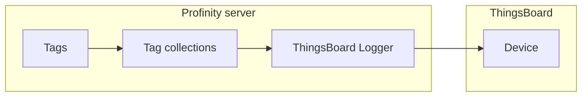

# ThingsBoard Logger

The ThingsBoard Logger publishes the values of selected [tag collections](../../Tags/Collections/index.md) from a Profile to a device in ThingsBoard.
In Snapshot mode it sends the current value of each member at each Update Interval (seconds).
In On Change and Everything modes, the Update Interval sets the flush timing.
It appears under **Loggers** in **ADD COMPONENT** after the ThingsBoard Logger plugin is installed.
A Profile holds only one.

The logger needs the Data Relay licensed feature.
Refer to [Install and manage plugins](../../Administration/Install_and_Manage_Plugins.md) to install the plugin, and to [Licensing](../../Licensing.md) for the editions that include Data Relay.

<figure markdown>

<figcaption>The ThingsBoard Logger sends tag collections from the Profinity server to a ThingsBoard device over Message Queuing Telemetry Transport (MQTT)</figcaption>
</figure>

!!! info "Licence required"
    The ThingsBoard Logger requires the **Data Relay** licensed feature, included in the **Server** and **Enterprise** editions.
    Without it the component is unavailable.
    Refer to [Licensing](../../Licensing.md) for what each edition includes.

## Quick start

You need the Data Relay licensed feature, the ThingsBoard Logger plugin installed, and the access token and device ID for the ThingsBoard device.

1. Install the ThingsBoard Logger plugin. Refer to [Install and manage plugins](../../Administration/Install_and_Manage_Plugins.md).
2. Add **ThingsBoard Logger** from **ADD COMPONENT**, under **Loggers**. A Profile holds only one.
3. Enter the device's access token in **ThingsBoard Access Token**.
4. Enter the device ID in **ThingsBoard Device ID**.
5. Under **Collections**, select at least one tag collection. The component cannot start without one.
6. Select **ADD COMPONENT** at the bottom of the dialog.
   When the add succeeds, the dialog title is **Error**, with the error icon, and the message is **Successfully created the component**.
7. Check that the component status shows **On**. If it shows **Error**, read the Profinity System Logs for the reason.

## Add the component

Only one ThingsBoard Logger can exist in a Profile.
Add it from **ADD COMPONENT** (refer to [How to add a component to your profile](../../How_To_Guides/Add_Component_to_Profile.md)) and choose **ThingsBoard Logger** under **Loggers**.
Complete the settings in the following table.

| Setting | Type | Default | Notes |
|---|---|---|---|
| **Name** | Text | ThingsBoard Logger | The name shown in the Profile. |
| **ThingsBoard Access Token** | Secret | None | The access token for the device. Required, and stored encrypted. |
| **ThingsBoard Device ID** | Text | None | The device ID in ThingsBoard. Required. Profinity also uses it as the MQTT client ID. |
| **Update Interval (seconds)** | Time | 60 | Seconds between samples sent to ThingsBoard, from 1 to 86400. |
| **Collections** | Choice | None | The tag collections to send. At least one is required. |
| **Logging mode** | Choice | Snapshot | Chooses between **Snapshot**, **On Change** and **Everything**. Refer to [Logging modes](../Logging_Modes.md) for what each mode sends. |
| **Auto Connect** | On or off | On | Starts sending when the Profile loads. Refer to [Connections and reconnecting](../Connections_and_Reconnecting.md). |

A collection must be selected before the component can start.
It connects out from the Profinity server to thingsboard.cloud using MQTT on TCP port 1883, so the firewall or network must allow that outbound connection.
No inbound port is needed.

## Troubleshooting

The component can be saved only with an access token and a device ID.

| What you see | Cause | What to do |
|---|---|---|
| The message "You must provide a device access token." | The access token is empty. | Enter the access token. |
| The message "You must provide a device ID." | The device ID is empty. | Enter the device ID. |
| ThingsBoard Logger is not in **ADD COMPONENT** | The plugin is not installed, or Data Relay is not licensed. | Install the plugin and check the licence for the Profile. |
| No data reaches ThingsBoard after the component is added | The token and device ID do not match the device in ThingsBoard. | Check the token and device ID against the device in ThingsBoard. |
| No data reaches ThingsBoard after the component is added | No collection is selected. | Select at least one collection. |
| No data reaches ThingsBoard after the component is added | Outbound traffic on port 1883 is blocked. | Allow outbound traffic on port 1883. |

Then read the Profinity logs for the connection error.
For the shared settings of MQTT components, refer to [MQTT Publisher](../Publishers_and_Subscribers/MQTT_Publisher.md).
