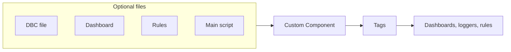

# Using a Custom Component

A Custom Component adds a device or function that Profinity does not have built in, such as a third-party CAN device, without a compiled plugin.
Once it is in a [Profile](../../Getting_Started/Profiles.md), Profinity monitors, graphs, logs, and secures it the same way as a built-in component, and loggers, rules, and scripts bind to it like any other component.

A Custom Component needs only a name.
Each of these parts is optional:

- A CAN database (DBC) file, which adds **Messages and Signals** and **Edit DBC File** to the component menu, as on built-in components such as the [Elmar Solar MPPT](../MPPT/Elmar_Solar_MPPT.md).
- A [dashboard](../../Customising_Profinity/Dashboards/index.md), which is the component's page.
- A rules file, which raises alerts from the component's tags.
- A long-running main [script](../../Developing_with_Profinity/Scripting/index.md), which can publish live values as tags.
- Menu actions, a settings map, a firmware map, and firmware actions.

<figure markdown>

<figcaption>A Custom Component takes its optional files and publishes tags that dashboards, loggers, and rules use</figcaption>
</figure>

For a first build, follow [Make your first Custom Component](../../Developing_with_Profinity/Custom_Components/First_Custom_Component.md).
[Custom Components](../../Developing_with_Profinity/Custom_Components/index.md) describes the files and compares a Custom Component with a [Dashboard Component](../Dashboard/Dashboard_Component.md) and a dynamic-link library (DLL) plugin.

## Quick start {#add-a-custom-component}

You need:

- An edition with the **Custom Plugins** licensed feature, and the **Scripting** licensed feature to run a main script. The Desktop, Server, and Enterprise editions include both, as described in [Licensing](../../Licensing.md).
- The **Modify components** permission.

1. Select **ADD COMPONENT**, then select **Custom Component**.
2. Enter a **Name** that is unique in the Profile.
3. Select **ADD COMPONENT**.
4. Check that the component appears in the side menu and opens its dashboard.

To attach files, select **Change Settings** from the component's menu and use the **Pack files** and **Scripts** tabs described in [Settings](#settings).
Without the **Scripting** feature, the component uses its DBC file, dashboard, and rules, and does not run the main script.

## Settings

The settings dialog has the **Settings**, **Pack files**, **Scripts**, and **Security** tabs.
Each file field on **Pack files** is optional, so leave a field empty when the component does not need that file.
The format of each YAML file is in [Custom Component files](../../Developing_with_Profinity/Custom_Components/Files.md).

| Setting | Tab | Type | Default | Effect |
|---|---|---|---|---|
| **Rebase DBC** | **Settings** | On or off | Off | Resets the DBC file to the base address in **Rebase Address**. |
| **Rebase Address** | **Settings** | Hexadecimal number | `0x0` | The base CAN address of the device, to which Profinity resets the addresses of the DBC file when **Rebase DBC** is on. |
| **Upload DBC File (Optional)** | **Pack files** | File upload | None | The DBC file that decodes the component's CAN messages. |
| **Upload Dashboard (Optional)** | **Pack files** | File upload | None | The dashboard YAML file that is the component's page. |
| **Rules YAML file (Optional)** | **Pack files** | File upload | None | The [tag rules](../../Tags/Rules/index.md) for the component's tags. |
| **Actions YAML file (Optional)** | **Pack files** | File upload | None | The menu actions the component offers. |
| **Settings Map YAML file (Optional)** | **Pack files** | File upload | None | Extra settings that the component shows on its **Settings** tab. |
| **Firmware Map YAML file (Optional)** | **Pack files** | File upload | None | The firmware fields the component shows. |
| **Firmware Actions YAML file (Optional)** | **Pack files** | File upload | None | The firmware actions the component offers. |
| **Main Script (Optional)** | **Scripts** | File upload | None | A C#, Python, or Lua script that runs for as long as the component runs, as described in [Main script](../../Developing_with_Profinity/Custom_Components/Main_Script.md). |
| **Auto Start Main Script** | **Scripts** | On or off | Off | Starts the main script when the Profile loads. When off, start it with **Start Main Service** from the component's menu. |
| **Mode** | **Security** | Choice | `All` | `All` lets everyone see the component, and `Restricted` limits it to **Allowed roles**. The tab is shown to users with the **Security administration** permission. |

A component installed from a pack on another installation shows **Name**, **Tag tree path**, menu placement, and the fields from the pack's settings map, and it hides **Pack files** and **Scripts**, because those files belong to the pack.
To pack a component for other installations, refer to [Pack a Custom Component for other installations](Pack_a_Custom_Component.md).

## Tags

A Custom Component publishes the signals of its DBC file under its `DBC` folder, and any tags its main script publishes.
A dashboard can bind to the script's tags whether or not the component has a DBC file.
For the DBC, dashboard, and rules files together, refer to [DBC, dashboard, and rules](../../Developing_with_Profinity/Custom_Components/DBC_Dashboard_and_Rules.md).

## Example

This example adds a Custom Component with a dashboard and a main script that starts when the Profile loads.
Add it under `components:` in the `profile.yaml` file of the Profile.

```yaml
- component:
    type: CustomComponent
    id: CustomComponent1
    name: YOUR_COMPONENT_NAME
    tagTreeParentPath: /
    dashboardFilename: YOUR_DASHBOARD.yaml
    mainScriptFilename: YOUR_SCRIPT.py
    autoStart: true
```

Replace `YOUR_COMPONENT_NAME` with a name that is unique in the Profile, and `YOUR_DASHBOARD` and `YOUR_SCRIPT` with the names of the files you uploaded in **Upload Dashboard (Optional)** and **Main Script (Optional)**, which store them in the profile's `dashboards` and `scripts` folders.
The script file can end in `.cs`, `.py`, or `.lua`.
`autoStart` is **Auto Start Main Script**.

## Check the component {#check-the-component}

1. Check that the component is in the side menu and opens its dashboard.
2. If you set a main script and **Auto Start Main Script** is off, select **Start Main Service** from the component's menu.
3. Check that the tags the script publishes update on the dashboard.
4. If you attached a DBC file, open **Messages and Signals** and check that the device's messages arrive. To check without the device, supply recorded traffic as described in [How to replay CAN bus logs](../../How_To_Guides/Replay_CAN_Logs.md).

## Troubleshooting

| What you see | Cause | What to do |
|---|---|---|
| "There is already a component in this profile with that name" | Another component in the Profile has the same name. | Enter a different **Name**. |
| The script's tags do not update | The main script has not started, because **Auto Start Main Script** is off or the edition has no **Scripting** feature. | Select **Start Main Service** from the component's menu, or turn on **Auto Start Main Script**. If the action is not shown, check the edition in [Licensing](../../Licensing.md). |
| **Messages and Signals** shows no messages | The device is not sending on a CAN adapter in the Profile, or the DBC addresses differ from the device's addresses. | Check that the CAN adapter is connected. If the device uses other addresses than the DBC file, set **Rebase DBC** and **Rebase Address** on the **Settings** tab. |
| **Pack files** and **Scripts** are missing from the settings | The component was installed from a pack, which owns its files. | Change the files in the pack and install it again, as described in [Pack a Custom Component for other installations](Pack_a_Custom_Component.md). |
