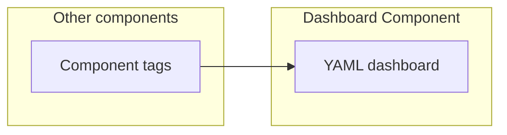
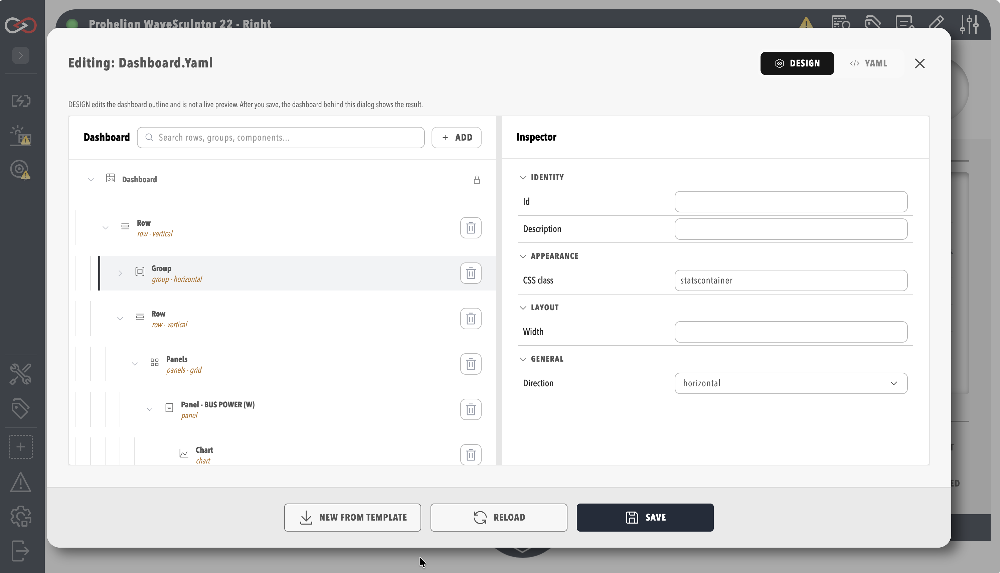

# Dashboard Component

A Dashboard Component is a built-in profile component that renders a dashboard defined entirely in YAML.
You can edit it in the visual dashboard editor.

Use it for human-machine interface (HMI) style screens that bind only to [tags](../../Tags/index.md) that already exist.

It is included in every edition.
It differs from a [Custom Component](../Custom_Components/Using_a_Custom_Component.md) in that it has no CAN database (DBC), script, or pack files, so you upload only the dashboard itself.

## Quick start

**You need** the **Modify components** permission to add the component, and the **Security administration** permission to view its dashboard, as described under [Roles and permissions](../../Administration/Users_and_Access/Roles_and_Permissions.md).

1. Select **ADD COMPONENT**, then select **Dashboard Component** in the **Dashboards** group.
2. Keep **Name** at `Dashboard Component`, or enter a name that is unique in the profile. Profinity refuses a name that matches an existing dashboard file, with the message "There is already a component in this profile with that name".
3. Optional: To start from your own dashboard, select **Upload Dashboard (Optional)** and choose a `.yaml` file. Leave it empty to create a template.
4. Select **ADD COMPONENT** at the bottom of the dialog.
5. If you left the upload empty, the dashboard editor opens on the template. Bind each element to a tag from another component by its absolute path, which starts with `/`, such as `/Prohelion BMU/DBC/PackStateOfCharge/SOCPercent`.
6. Open the component's dashboard, and check that the bound elements show the values of their tags.

## Add the component {#add-a-dashboard-component}

Add the component from **ADD COMPONENT** (refer to [How to add a component to your profile](../../How_To_Guides/Add_Component_to_Profile.md)), where it is listed under **Dashboards**.
Its only setting besides the name is **Upload Dashboard (Optional)**, which takes a `.yaml` dashboard file.
When no file is uploaded, Profinity creates a template dashboard that the dashboard editor opens for editing, as described in [Using a custom component](../Custom_Components/Using_a_Custom_Component.md).
A component name that matches an existing dashboard file in the profile is rejected with the message "There is already a component in this profile with that name".

## Example

This example is a Dashboard Component entry.
Add it under `components:` in the `profile.yaml` file of the profile.

```yaml
- component:
    type: DashboardComponent
    id: DashboardComponent1
    name: YOUR_DASHBOARD_NAME
    tagTreeParentPath: /
    dashboardFilename: YOUR_DASHBOARD_NAME.yaml
```

Replace `YOUR_DASHBOARD_NAME` with a name that is unique in the profile.
When you leave `dashboardFilename` out, Profinity uses the component name followed by `.yaml`.
The dashboard file sits in the `dashboards` folder of the profile. Upload it with **Upload Dashboard (Optional)**, or let Profinity create the template there.

## Building the dashboard

Dashboards are written in YAML.
You can edit them in the [Visual Editor](../../Customising_Profinity/Dashboards/Build_a_Dashboard.md), with the same layout, data, and interactive components available as on any other dashboard.

<figure markdown>

<figcaption>A YAML dashboard in a Dashboard Component shows the tags of other components, which it binds to by absolute path</figcaption>
</figure>

<figure markdown>

<figcaption>Dashboard visual editor</figcaption>
</figure>

A relative tag path in a Dashboard Component starts at the Dashboard Component itself.
The component has no DBC, so a path such as `DBC/BusMeasurement/BusVoltage` finds no tag there.
Bind to the tags of another component with an absolute path that starts with `/`, such as `/Prohelion BMU/DBC/PackStateOfCharge/SOCPercent`, where `Prohelion BMU` is the name of the BMU component in the [Example Profile](../../Administration/Profiles.md#shipped-example).
Use the name of your own component.

To connect the dashboard to tags, refer to [Data binding](../../Customising_Profinity/Dashboards/Data_Binding/index.md).
For each element, refer to the [Component reference](../../Customising_Profinity/Dashboards/Component_Reference/index.md).
Worked guides are [How to create a custom dashboard](../../How_To_Guides/Create_Custom_Dashboard.md) and [Profile Dashboard](../../Administration/Profile_Dashboard.md).

## Troubleshooting

| What you see | Cause | What to do |
|---|---|---|
| "There is already a component in this profile with that name" | The name matches another component in the profile, or matches an existing dashboard file | Enter a name that is unique in the profile, then select **ADD COMPONENT**. |
| An element bound with a relative path shows no value | A relative path starts at the Dashboard Component, which has no DBC tags, so the path finds no tag | Bind the element with an absolute path that starts with `/`, such as `/Prohelion BMU/DBC/PackStateOfCharge/SOCPercent`, using the name of your own component. |

