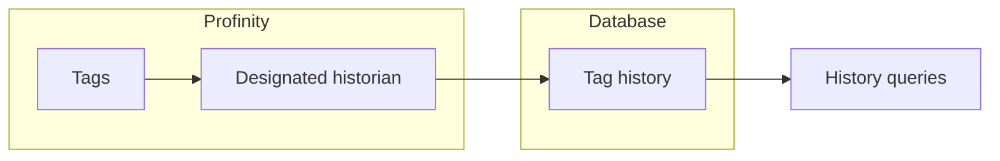

# Designated historian

More than one [historian](index.md) can write in the same profile, but exactly one of them answers long-range tag and history queries. A second historian is for logging different collections in different historians. Retrieval still uses only one of them.
Enable **Designated tag historian reader** on that one component and leave it disabled on the others.
A new [TAG Local Historian](TAG_Local_Historian.md) has this setting on by default so a simple profile can answer history queries with only this checkbox.

<figure markdown>

<figcaption>Tag history is written by each historian, and long-range history queries are answered from the store of the historian that has Designated tag historian reader enabled</figcaption>
</figure>

If no component is designated, or more than one is, Profinity has no store to read history from and does not answer long-range queries.
In that case, a dashboard shows only the values in memory, and the **Live** and **View at a time** control does not appear in its title bar.
An InfluxDB historian is designated only while its **Allow Retrieval** setting is also enabled.
**Allow Retrieval** exists only on the [InfluxDB historians](InfluxDB_Historians.md).
**Designated tag historian reader** is described on the page of each historian: [TAG Local Historian](TAG_Local_Historian.md), [InfluxDB historians](InfluxDB_Historians.md) and [TAG SQL Historian](TAG_SQL_Historian.md).

Dashboards use the designated historian for older values in a chart window, and for viewing a dashboard at a past time, as described in [View a dashboard at a past time](../../How_To_Guides/View_Dashboard_at_a_Past_Time.md).
To set up logging, refer to [How to configure data logging](../../How_To_Guides/Configure_Data_Logging.md).
