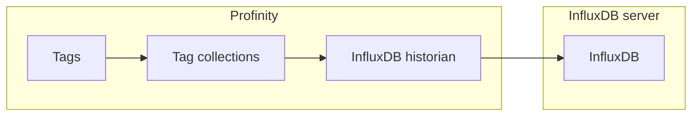

# InfluxDB historians

The **InfluxDB v2 Historian** and the **InfluxDB v3 Historian** write the values of the tags in the [collections](../../Tags/Collections/index.md) you select to an InfluxDB server.
They also allow that history to be read back through the APIs.
They sit in the **Historians** category.
Each recorded value belongs to a [tag](../../Tags/index.md), identified by its [tag tree path](../../Tags/Selecting_Tags/Tag_Tree_Path.md).

Use the **InfluxDB v2 Historian** if your InfluxDB server stores data in buckets that belong to an organisation.
Use the **InfluxDB v3 Historian** if your InfluxDB server stores data in a single database.
Both authenticate with a token.
InfluxDB Cloud is supported as well as a server you host: enter the Cloud URL and a token in the same way.

<figure markdown>

<figcaption>An InfluxDB historian writes the tags in the selected collections to the InfluxDB server, and the APIs read the history back</figcaption>
</figure>

!!! info "Licence required"
    The InfluxDB v2 Historian and the InfluxDB v3 Historian require the **Historians** licensed feature. Refer to [Licensing](../../Licensing.md) for the editions that include them.

Check which InfluxDB version your server runs before adding a component.
InfluxDB v1, v2 and v3 are incompatible, and a component only connects to the version it was built for, so a mismatch causes connection failures.
An InfluxDB v1 server needs the [InfluxDB v1 Logger](../Loggers/InfluxDB_v1_Logger.md), which is a logger rather than a historian.

## Quick start {#adding-an-influxdb-historian}

You need a running InfluxDB v2 or v3 server, a token for it, and the **Historians** licensed feature.

1. Select **ADD COMPONENT**, then select **InfluxDB v2 Historian** in the **Historians** category.
2. Enter **InfluxDB Bucket** and **InfluxDB Organisation**, then enter your **InfluxDB Token**.
3. Under **Collections**, add at least one tag collection. The historian does not start without one.
4. If InfluxDB runs on another computer, enter its address in **Influx Server URL**. The default is `http://localhost:8086/`.
5. Select **ADD COMPONENT** at the bottom of the dialog. **Auto Connect** is on by default, so the historian starts when the profile loads. If it is off, select **Start Logger** from the component's menu.
6. Check that **STATUS** shows **On**. Data appears in InfluxDB after the first **Update Interval (Seconds)**, which is 10 seconds by default.

For the **InfluxDB v3 Historian**, enter **InfluxDB Database** in place of **InfluxDB Bucket** and **InfluxDB Organisation**.

The first three settings identify where the data is stored, and differ between the two historians.

| Setting | Type | Applies to | Default | Purpose |
|---|---|---|---|---|
| **InfluxDB Bucket** | Text | InfluxDB v2 Historian | None | The InfluxDB bucket that the data is stored in. Required. |
| **InfluxDB Organisation** | Text | InfluxDB v2 Historian | None | The InfluxDB organisation that owns the bucket. Required. |
| **InfluxDB Database** | Text | InfluxDB v3 Historian | None | The InfluxDB v3 database that the data is stored in. Required. |

The remaining settings are the same on both historians.

| Setting | Type | Default | Purpose |
|---|---|---|---|
| **InfluxDB Token** | Secret | None | The security token of the InfluxDB user that Profinity connects as. Required, and stored encrypted. |
| **Influx Server URL** | Text | `http://localhost:8086/` | The endpoint URL that InfluxDB is running on. |
| **Dashboard URL** | Text | Blank | The URL of the InfluxDB dashboard. Optional, and leaving it blank shows no dashboard link. |
| **InfluxDB Health Check** | On or off | On | Checks the health of the InfluxDB server when the component connects and about every 30 seconds while it runs. Turn it off for InfluxDB Cloud, which does not support the check. |
| **Collections** | Choice | None | One or more [tag collections](../../Tags/Collections/index.md) whose tags are recorded. The picker shows display names (and group path); the profile stores the collection id. At least one collection must be configured before the component starts. |
| **Update Interval (Seconds)** | Time | 10 | How often data is sent, from 1 to 86400 seconds. |
| **Logging mode** | Choice | `Snapshot` | Sets what is sent on each interval: `Snapshot`, `On Change` or `Everything`. Refer to [Logging modes](../Logging_Modes.md). |
| **Auto Connect** | On or off | On | Starts the historian when the profile loads. When off, start it with **Start Logger**. Refer to [Connections and reconnecting](../Connections_and_Reconnecting.md). |
| **Allow Retrieval** | On or off | On | Allows data to be retrieved through this historian using the APIs. |
| **Designated tag historian reader** | On or off | Off | Makes this historian the store that long-range history queries are read from. Enable it on one component only, and only while **Allow Retrieval** is on. Refer to [Designated historian](Designated_Historian.md). |

## Example

These examples are historian entries in the `profile.yaml` file of a profile.
The first is an InfluxDB v2 Historian.

```yaml
components:
- component:
    type: InfluxDbHistorianV2
    id: InfluxDbHistorianV21
    name: InfluxDB v2 Historian
    tagTreeParentPath: /
    url: http://localhost:8086/
    bucket: YOUR_BUCKET
    organisation: YOUR_ORGANISATION
    token: YOUR_INFLUXDB_TOKEN
    intervalSec: 10
    logType: Snapshot
    allowRetrieval: true
    collections:
    - collectionName: YOUR_COLLECTION_ID
```

The second is an InfluxDB v3 Historian, which takes a database in place of a bucket and an organisation.

```yaml
components:
- component:
    type: InfluxDbHistorianV3
    id: InfluxDbHistorianV31
    name: InfluxDB v3 Historian
    tagTreeParentPath: /
    url: http://localhost:8086/
    database: YOUR_DATABASE
    token: YOUR_INFLUXDB_TOKEN
    intervalSec: 10
    logType: Snapshot
    collections:
    - collectionName: YOUR_COLLECTION_ID
```

Replace `YOUR_BUCKET`, `YOUR_ORGANISATION` and `YOUR_DATABASE` with the names in your InfluxDB server.
Replace `YOUR_INFLUXDB_TOKEN` with your InfluxDB token, which Profinity stores encrypted.
Replace `YOUR_COLLECTION_ID` with the id of a tag collection in the profile.

## What is stored

Every sample is written with its quality in a `quality` field.
A Good sample also has a `value` field, and a Stale sample keeps its last `value` with quality Stale.
A tag that is Unavailable or Bad is written as a gap, with a `quality` field and no `value`.

A chart can then show the gap instead of an invented reading.
Only tags that hold a number are written, and a query for readings should ask for the `value` field.

Each sample is stored as one point in a measurement named after the profile.
For example, a motor speed signal on a component called `Inverter` is stored like this:

| Part | Example | Meaning |
|---|---|---|
| Tag `component` | `Inverter` | The component that owns the tag. |
| Tag `message` | `Status` | The CAN message the signal belongs to. |
| Tag `signal` | `Speed` | The signal name. |
| Tag `full_tag_id` | `Inverter/DBC/Status/Speed` | The tag's path when the sample was written. |
| Field `value` | `23.4` | The reading. |
| Field `quality` | `Good` | The quality of the reading. |

In InfluxDB line protocol, that point is:

```text
MyProfile,profile=MyProfile,component=Inverter,message=Status,signal=Speed,full_tag_id=Inverter/DBC/Status/Speed value=23.4,quality="Good" 1792315200000000000
```

The `component`, `message` and `signal` tags identify the tag in the history.
Characters other than letters and digits in these names are replaced with underscores.

For the full procedure to send data to InfluxDB Cloud, refer to [How to log data to InfluxDB](../../How_To_Guides/Log_Data_to_InfluxDB.md).

## If data does not arrive

The Profinity system logs name the cause, and [Logs](../../Administration/Logs_Config.md) describes where to read them.
When the component cannot connect, it logs one error for the outage, in the form `<component name>: could not connect (<reason>). Retrying every 5 s.`
The reason tells you what to check.

| What you see | Cause | What to do |
|---|---|---|
| The log gives `credential validation failed (likely an invalid token)` as the reason | The token is wrong or lacks access. | Check the token. |
| The log gives `the health check failed (InfluxDB Cloud has none; switch Health Check off in the settings)` as the reason | The server did not answer the health check. | Turn **InfluxDB Health Check** off if you use InfluxDB Cloud. |
| The log gives any other text as the reason | The connection failed for another reason, and the text is the underlying error. | Check the **Influx Server URL** first. |

To add a historian and start it, refer to [How to configure data logging](../../How_To_Guides/Configure_Data_Logging.md).
For an InfluxDB v1 server, refer to [InfluxDB v1 Logger](../Loggers/InfluxDB_v1_Logger.md).
