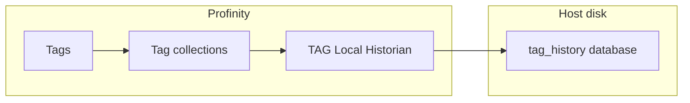

# TAG Local Historian

The **TAG Local Historian** writes the values of the tags in the [collections](../../Tags/Collections/index.md) you select to a SQLite database file that Profinity manages on the host.
It also allows that history to be read back through the APIs.
It sits in the **Historians** category.

Use it for simple or embedded setups where you want queryable history without entering a connection string or running a separate database server.
For a database you already operate (SQL Server, PostgreSQL, MySQL, Oracle, or a SQLite path you choose yourself), use the [TAG SQL Historian](TAG_SQL_Historian.md) instead.
For viewable CSV or JSON Lines files rather than queryable history, use the [TAG File Logger](../Loggers/Tag_File_and_SFTP_Loggers.md).

Each row the historian writes belongs to one [tag](../../Tags/index.md), identified by its [tag tree path](../../Tags/Selecting_Tags/Tag_Tree_Path.md).

<figure markdown>

<figcaption>The TAG Local Historian writes the tags in the selected collections to a managed SQLite file under tag_history, and the APIs read the history back</figcaption>
</figure>

!!! info "Licence required"
    The TAG Local Historian requires the **Historians** licensed feature.
    Refer to [Licensing](../../Licensing.md) for the editions that include it.

## Adding the historian {#adding-a-tag-local-historian}

To start recording:

1. Add a **TAG Local Historian** to your profile from the **Historians** category.
2. Under **Collections**, add at least one tag collection.
   The component needs one to be configured before it can start.
3. Choose the **Logging mode** and **Update Interval (Seconds)** if you need values other than the defaults.
4. Optionally change **Retention (days)** (default 30).
5. Leave **Designated tag historian reader** on unless another historian in the profile is already designated.
6. Save the settings.

There is no connection string, provider, or table name to configure.
Profinity creates the SQLite file under the site `tag_history/` directory when the historian starts.

Once it is running, its status shows **On**, and rows appear after the first **Update Interval (Seconds)**.
If a write fails, its status shows **Error** until a write succeeds.
The local database rejected a write, or its connection is not available.
Read the reason in the Profinity System Logs.
Check that the database file is on a writable drive with free space, and that no other program holds the file.

## Logger settings

| Setting | Default | Purpose |
|---|---|---|
| **Collections** | None | One or more [tag collections](../../Tags/Collections/index.md) whose tags are recorded. The picker shows display names (and group path); the profile stores the collection id. At least one collection must be configured before the component starts. |
| **Logging mode** | `Snapshot` | Sets what is written on each interval: `Snapshot`, `On Change` or `Everything`. Refer to [Logging modes](../Logging_Modes.md) for what each mode writes. |
| **Auto Connect** | On | Starts the historian when the profile loads. When off, start it with **Start Logger**. Refer to [Connections and reconnecting](../Connections_and_Reconnecting.md). |
| **Update Interval (Seconds)** | 10 | The seconds between writes to the database, from 1 to 86400. Refer to [Logging modes](../Logging_Modes.md) for how each mode uses it. |

## Data storage

| Setting | Default | Purpose |
|---|---|---|
| **Retention (days)** | 30 | Deletes stored samples older than this many days after each successful write interval. |
| **Designated tag historian reader** | On | Makes this historian the store that long-range history queries are read from. Enable it on one component only. Refer to [Designated historian](Designated_Historian.md). |

## Example

This example is a TAG Local Historian entry in the `profile.yaml` file of a profile.

```yaml
components:
- component:
    type: TagLocalHistorian
    id: TagLocalHistorian1
    name: TAG Local Historian
    tagTreeParentPath: /
    intervalSec: 10
    logType: Snapshot
    retentionDays: 30
    designatedTagDataStore: true
    collections:
    - collectionName: YOUR_COLLECTION_ID
```

Replace `YOUR_COLLECTION_ID` with the id of a tag collection in the profile.

## Where the database is stored

The file path is:

`{artefacts}/tag_history/{profile name}/{component name}.db`

On Linux the artefacts root is typically `/var/lib/prohelion/profinity`.
On Windows and macOS it is under the Prohelion Profinity application data folder.
The profile name and component name are kept as you named them (only characters that are illegal in a file name are removed).
The table inside the file is always `TagChangeLog`.

This directory is separate from `tag_logs/`, which holds viewable CSV and JSON Lines files from the TAG File Logger.

## Deleting the component

When you remove the TAG Local Historian from the profile, Profinity deletes its `.db` file and any SQLite sidecar files (`-wal`, `-shm`), and the history in them is lost.
Copy the files first if you need the history.
The files are at `tag_history/<profile>/<component>.db` in the [artefacts directory](../../Installation/Artifacts_Directory.md), with the `-wal` and `-shm` files beside the `.db` file.
Stop the component before you copy them.
Unloading a profile without removing the component leaves the file in place.

## Reading history back

With **Designated tag historian reader** enabled, dashboards and integrations that ask for long-range tag history use this store.
Refer to [Designated historian](Designated_Historian.md).

The row layout matches the TAG SQL Historian and the TAG File Logger field set.
Refer to [TAG SQL Historian](TAG_SQL_Historian.md#table-layout) for the column list.

!!! warning "Moving a component starts a new history in this historian"
    This historian records history under the tag's path, so moving a component changes its tag paths.
    The history recorded under the old paths stays there, and queries for the new path return a new series that begins with its first point.
    Refer to [Change the path on a deployed component](../../Tags/Selecting_Tags/Nest_a_Component_in_the_Tag_Tree.md#change-the-path-on-a-deployed-component).

For the steps to set up data logging, refer to [How to configure data logging](../../How_To_Guides/Configure_Data_Logging.md).
