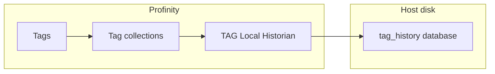

# TAG Local Historian

The **TAG Local Historian** records the values of the tags in the [collections](../../Tags/Collections/index.md) you select to a SQLite database file that Profinity manages on the host, and dashboards and integrations can read that history back.
It sits in the **Historians** group and needs no connection string or separate database server.

For a database you already run, such as SQL Server, PostgreSQL, MySQL, or Oracle, use the [TAG SQL Historian](TAG_SQL_Historian.md).
For CSV or JSON Lines files that you open and read yourself, use the [TAG File Logger](../Loggers/Tag_File_and_SFTP_Loggers.md).

<figure markdown>

<figcaption>The TAG Local Historian writes the tags in the selected collections to a SQLite file in the tag_history folder, and dashboards read the history back</figcaption>
</figure>

## Quick start {#adding-a-tag-local-historian}

You need an edition with the **Historians** licensed feature, as described in [Licensing](../../Licensing.md), and a [tag collection](../../Tags/Collections/index.md) that holds the tags to record.

1. Select **ADD COMPONENT**, then select **TAG Local Historian** in the **Historians** group.
2. Under **Collections**, add the collection that holds the tags to record. The historian needs a collection before it can start.
3. Keep **Auto Connect** on, which is its default, so that the historian starts when the profile loads.
4. Select **ADD COMPONENT**.
5. Check that the historian status shows **On**.

The historian writes a row for each tag after every **Update Interval (Seconds)**, 10 seconds by default.
The other settings keep their defaults, which suit most profiles, and the following tables list them.

## Settings

| Setting | Type | Default | Effect |
|---|---|---|---|
| **Collections** | Choice | None | The [tag collections](../../Tags/Collections/index.md) whose tags are recorded. The picker shows each collection's display name, and the profile stores its `id`. |
| **Logging mode** | Choice | `Snapshot` | What is written on each interval: `Snapshot`, `On Change`, or `Everything`. Refer to [Logging modes](../Logging_Modes.md). |
| **Auto Connect** | On or off | On | Starts the historian when the profile loads. When it is off, start the historian with **Start Logger** from its menu. Refer to [Connections and reconnecting](../Connections_and_Reconnecting.md). |
| **Update Interval (Seconds)** | Whole number | `10` | The seconds between writes, from 1 to 86400. |
| **Retention (days)** | Whole number | `30` | After each write, Profinity deletes samples older than this many days. |
| **Designated tag historian reader** | On or off | On | Makes this historian the one that dashboards and integrations read older tag history from. Turn it on for exactly one historian in the profile. Refer to [Designated historian](Designated_Historian.md). |

Because the default is on, turn **Designated tag historian reader** off on this historian when another historian in the profile is already the reader.
When two or more historians have it on, Profinity uses none of them, and windows of older history return no data.

## Example

Add this item under `components:` in the `profile.yaml` file of the profile.
Each profile has its own folder in the `profiles` folder of the [artefacts directory](../../Installation/Artifacts_Directory.md).

```yaml
- component:
    type: TagLocalHistorian
    id: TagLocalHistorian1
    name: TAG Local Historian
    tagTreeParentPath: /
    intervalSec: 10
    logType: Snapshot
    retentionDays: 30
    designatedTagDataStore: true
    collections:
    - collectionName: <collection id>
```

Replace `<collection id>` with the `id` of the collection, which is in the `collections.yaml` file of the profile.
The keys match the settings in this order: `intervalSec` is **Update Interval (Seconds)**, `logType` is **Logging mode**, `retentionDays` is **Retention (days)**, `designatedTagDataStore` is **Designated tag historian reader**, and `collections` is **Collections**.

## Where the database is stored

The historian keeps its database at `tag_history/<profile name>/<component name>.db` in the [artefacts directory](../../Installation/Artifacts_Directory.md#default-locations), and Profinity creates the file when the historian starts.
The profile and component names are kept as you typed them, apart from characters that a file name cannot hold.
The table inside the file is `TagChangeLog`, and its columns match the [TAG SQL Historian table layout](TAG_SQL_Historian.md#table-layout).

The `tag_history` folder is separate from `tag_logs`, which holds the files that the TAG File Logger writes.

## Removing the component

!!! warning "Removing the component deletes its history"
    Removing the TAG Local Historian from the profile deletes its `.db` file and the `-wal` and `-shm` files that SQLite keeps beside it, and the history in them is lost.

To keep the history:

1. Select **Stop Logger** from the historian's menu.
2. Copy `<component name>.db`, and any `<component name>.db-wal` and `<component name>.db-shm` files, from `tag_history/<profile name>/` in the artefacts directory to a folder outside the artefacts directory.
3. Check that the copies are the same size as the originals.
4. Remove the component from the profile.

To read the history again, open the copied `.db` file with any SQLite tool.
Unloading a profile leaves the file in place, because only removing the component deletes it.

## Reading history back

The designated historian serves the older part of a dashboard's time window and of the history that integrations request, as described in [Designated historian](Designated_Historian.md).

!!! info "Moving a component starts a new history"
    The historian records each tag under its path, so moving a component to another place in the tag tree starts a new series at the new path.
    The history under the old path stays in the file.
    Refer to [Change the path on a deployed component](../../Tags/Selecting_Tags/Nest_a_Component_in_the_Tag_Tree.md#change-the-path-on-a-deployed-component).

## Troubleshooting

| What you see | Cause | What to do |
|---|---|---|
| The status shows **Off** | No collection is selected under **Collections**, or **Auto Connect** is off. | Add a collection under **Collections**. If **Auto Connect** is off, select **Start Logger** from the historian's menu. |
| The status shows **Error** until a write succeeds | The database rejected a write, or the file cannot be opened. | Read the reason on the **Logs** page under **ADMIN**. Check that the drive that holds the artefacts directory is writable and has free space, and that no other program has the file open. |
| A chart that reaches back to older values shows no data | More than one historian has **Designated tag historian reader** on, or none has. | Turn **Designated tag historian reader** on for exactly one historian in the profile. |

For the steps to set up data logging across a profile, refer to [How to configure data logging](../../How_To_Guides/Configure_Data_Logging.md).
