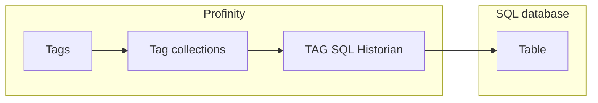

# TAG SQL Historian

The **TAG SQL Historian** writes the values of the tags in the [collections](../../Tags/Collections/index.md) you select to a table in a Structured Query Language (SQL) database.
It also allows that history to be read back through the APIs.
It sits in the **Historians** category.
Use it when the history needs to live in a database that you already operate and query with ordinary SQL tools, rather than in a time-series database such as [InfluxDB](InfluxDB_Historians.md).

If you only need on-box SQLite with no connection string, use the [TAG Local Historian](TAG_Local_Historian.md) instead.
Each row the historian writes belongs to one [tag](../../Tags/index.md), identified by its [tag tree path](../../Tags/Selecting_Tags/Tag_Tree_Path.md).

<figure markdown>

<figcaption>The TAG SQL Historian writes the tags in the selected collections to a table in the SQL database, and the APIs read the history back</figcaption>
</figure>

!!! info "Licence required"
    The TAG SQL Historian requires the **Historians** licensed feature. Refer to [Licensing](../../Licensing.md) for the editions that include it.

## Quick start {#adding-a-tag-sql-historian}

You need the Historians licensed feature, a database that the Profinity server can reach, and an account that can insert into and select from the table. With **Auto create table** on, the account also needs permission to create the table.

1. Add a **TAG SQL Historian** from the **Historians** category.
2. Set **Connection string** to the connection string for your database, in the format of the provider you choose.
3. If the database is not SQLite, set **Database provider** to match it. SQLite is the default.
4. Under **Collections**, add at least one tag collection. The historian cannot start without one.
5. Select **ADD COMPONENT** at the bottom of the dialog.
6. Check that the status shows **On**. In Snapshot mode, the default **Logging mode**, rows appear in the table named by **Table name** after each **Update interval (seconds)**, which is 10 seconds by default. If the status shows **Error**, read the [Logs](../../Administration/Logs_Config.md) for the reason.

The following tables describe every setting.

### Connection settings

| Setting | Type | Default | Purpose |
|---|---|---|---|
| **Database provider** | Choice | SQLite | The SQL engine to connect to: **SQLite**, **SQL Server / Azure SQL**, **PostgreSQL**, **MySQL** or **Oracle**. |
| **Connection string** | Secret | None | The connection string for the chosen database provider, in that provider's own format. Required. Profinity encrypts it in the profile file when the profile is saved, unless it is an environment variable reference. |
| **Table name** | Text | `TagChangeLog` | The table the historian writes rows to. Use letters, digits, and underscores only, and do not start with a digit. |
| **Auto create table** | On or off | On | Creates the table when the historian starts, if it does not already exist. |

### Logger settings

| Setting | Type | Default | Purpose |
|---|---|---|---|
| **Collections** | Choice | None | One or more [tag collections](../../Tags/Collections/index.md) whose tags are recorded. The picker shows display names (and group path); the profile stores the collection id. At least one collection must be configured before the component starts. |
| **Logging mode** | Choice | `Snapshot` | Sets what is written on each interval: `Snapshot`, `On Change` or `Everything`. Refer to [Logging modes](../Logging_Modes.md) for what each mode writes. |
| **Auto connect** | On or off | On | Starts the historian when the profile loads. When off, start it with **Start Logger**. Refer to [Connections and reconnecting](../Connections_and_Reconnecting.md). |
| **Update interval (seconds)** | Time | 10 | The seconds between writes to the database, from 1 to 86400. Refer to [Logging modes](../Logging_Modes.md) for how each mode uses it. |
| **Designated tag historian reader** | On or off | Off | Makes this historian the store that long-range history queries are read from. Enable it on one component only. Refer to [Designated historian](Designated_Historian.md). |

## Table layout

Every sample is written with its quality.
A Stale sample keeps its last value.
A tag that is Unavailable or Bad is written with its quality and an empty value, so the table shows the gap.

When **Auto create table** is enabled, the historian creates a table with these columns.
The names are the same on every provider.

| Column | Contents |
|---|---|
| `Id` | An automatically generated row identifier. |
| `RecvTime` | The time the value was received. |
| `TagId` | The path of the tag. |
| `ValueType` | The data type of the value. |
| `Value` | The recorded value. |
| `UtcTimestamp` | The Coordinated Universal Time (UTC) timestamp of the sample. |
| `Quality` | The data quality of the sample: Good, Stale, Unavailable, or Bad. |
| `Reason` | Why the sample was recorded. |
| `Message` | An optional message. |

For example, a motor speed tag is stored as this row:

| Column | Example |
|---|---|
| `Id` | `1` |
| `RecvTime` | `2026-10-18T19:15:02.1234567+10:00` |
| `TagId` | `Inverter/DBC/Status/Speed` |
| `ValueType` | `Double` |
| `Value` | `23.4` |
| `UtcTimestamp` | `2026-10-18T09:15:02.0000000Z` |
| `Quality` | `Good` |
| `Reason` | `ok` |
| `Message` | empty |

A row for a tag that is Unavailable or Bad has the same layout with an empty `ValueType` and `Value`, and its `Quality` says why there is no reading.

The columns follow the same field set as the TAG File Logger, described in [Tag file and SFTP loggers](../Loggers/Tag_File_and_SFTP_Loggers.md), so you can interpret history written by either in the same way.
If you create the table yourself, disable **Auto create table** and give the account in the connection string permission to insert into and read from it.

## Example connection strings

The connection string uses the format of the chosen provider.
Replace the host names, database names, account names and `<password>` in the examples with your own.

| Provider | Example |
|---|---|
| SQLite | `Data Source=/var/lib/prohelion/profinity/history.db`. SQLite creates the file at the path you give, so use a full path to a folder the Profinity service can write to. Profinity passes the string through unchanged, so give the path in the form your computer uses, such as `Data Source=C:\path\to\file.db` on Windows. |
| SQL Server / Azure SQL | `Server=dbhost,1433;Database=Profinity;User Id=profinity;Password=<password>;Encrypt=True` |
| PostgreSQL | `Host=dbhost;Port=5432;Database=profinity;Username=profinity;Password=<password>` |
| MySQL | `Server=dbhost;Port=3306;Database=profinity;User ID=profinity;Password=<password>` |
| Oracle | `User Id=profinity;Password=<password>;Data Source=dbhost:1521/ORCLPDB1` |

The account in the connection string needs permission to insert into and select from the table.
With **Auto create table** on, it also needs permission to create the table, and you can remove that permission after the first start.

## Example

This example is for illustration.
It records the tags in one collection to a PostgreSQL table every 10 seconds.
Add it under `components:` in the `profile.yaml` file of the profile.

```yaml
- component:
    type: TagSqlHistorian
    id: TagSqlHistorian1
    name: TAG SQL Historian
    tagTreeParentPath: /
    provider: PostgreSql
    connectionString: Host=DB_HOST;Port=5432;Database=profinity;Username=profinity;Password=DB_PASSWORD
    tableName: TagChangeLog
    autoCreate: true
    logType: Snapshot
    intervalSec: 10
    autoConnect: true
    designatedTagDataStore: false
    collections:
    - collectionName: COLLECTION_ID
```

Replace `DB_HOST` and `DB_PASSWORD` with the host name and password of your database, and `COLLECTION_ID` with the id of a [tag collection](../../Tags/Collections/index.md).
Each value is a setting from the [Connection settings](#connection-settings) or [Logger settings](#logger-settings) section.
Profinity stores the connection string encrypted when it saves the profile. Until then, a password written in plain text stays readable in the file.

## If the historian does not start

Settings cannot be saved in two cases. When the settings save but no rows arrive, the Profinity system logs show one of two messages.

| What you see | Cause | What to do |
|---|---|---|
| Settings do not save, and the message `You must provide a connection string for the database.` appears | No connection string is entered. | In **Connection string** under **Connection settings**, enter the connection string for the database in the syntax of the selected **Database provider**, then save the settings. |
| Settings do not save, and the message `Table name must use letters, digits, and underscore only, and cannot start with a digit.` appears | The table name is invalid. | In **Table name** under **Connection settings**, enter a name that uses only letters, digits, and underscores, and does not start with a digit, such as `TagChangeLog`, then save the settings. |
| Settings save, but no rows arrive, and the log shows the component name followed by `could not connect` and the reason. The historian shows **Error** and retries every 5 seconds until the database is reachable. | The connection failed, and the log gives the reason. | Check the connection string, that the database is reachable from the Profinity server, and that the account can write to the table. |
| Settings save, but no rows arrive, and the log shows the component name followed by `writing failed` and the reason. Profinity logs the first failure at warning level and further failures at debug level until a write works again. | A write failed, and the log gives the reason. | Check the connection string, that the database is reachable from the Profinity server, and that the account can write to the table. |

Refer to [Logs](../../Administration/Logs_Config.md) for where to read them.

!!! warning "Moving a component starts a new history in this historian"
    This historian records history under the tag's path, so moving a component changes its tag paths.
    The history recorded under the old paths stays there, and queries for the new path return a new series that begins with its first point.
    The InfluxDB historians and loggers and the Prometheus logger identify a tag by its component, message, and signal instead, so their history carries on after a move.
    Refer to [Change the path on a deployed component](../../Tags/Selecting_Tags/Nest_a_Component_in_the_Tag_Tree.md#change-the-path-on-a-deployed-component).

For the steps to set up data logging, refer to [How to configure data logging](../../How_To_Guides/Configure_Data_Logging.md).
