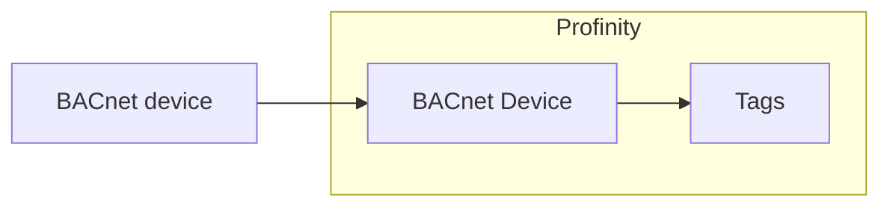

# BACnet

The **BACnet Device** component reads one Building Automation and Control Networks (BACnet) device over an Internet Protocol (IP) network and publishes the objects you choose as Profinity tags.
BACnet is used for building automation and for heating, ventilation, and air conditioning (HVAC) systems.
The component sits in the **Industrial Protocols** group.

<figure markdown>

<figcaption>The BACnet Device component polls the objects in its point map from one BACnet device and publishes each as a Profinity tag</figcaption>
</figure>

Add one component for each BACnet device you want to read.
The component supports BACnet/IP only, not BACnet MS/TP (Master-Slave/Token-Passing).
It talks only to the device at the **Remote host** address you set, so it does not search the network for devices.

## Quick start

You need:

- An edition with the **Industrial Protocols** licensed component group, and the BACnet plugin installed, as described in [Install an industrial protocol plugin](Install_an_Industrial_Protocol_Plugin.md).
- A BACnet/IP device that the computer running Profinity can reach on the network, and its device instance number, which a BACnet configuration tool or the device's own display shows.
- The **Security administration** permission to view the component dashboard in step 7.

1. Select **ADD COMPONENT**, then select **BACnet Device** in the **Industrial Protocols** group.
2. In the settings dialog, set **Remote host** to the IP address of the BACnet device.
3. Set **Device instance** to the instance number of that device.
4. In the **Point map**, add one row with a **Name**, an **Object type**, and an **Instance**.
5. Select **ADD COMPONENT** at the bottom of the dialog.
6. Select **Connect / Disconnect** from the component's menu. **Auto Connect** is off by default, so the component does not connect on its own.
7. On the component dashboard, check that **STATUS** shows **Connected** and **CONNECTED** is true, and that the tag for your row, under the component's **Points** folder, shows Good quality.

To change the settings later, select **Change Settings** from the component's menu, then select **SAVE**.

## Communications settings

| Setting | Type | Default | Description |
|---|---|---|---|
| **Name** | Text | `BACnet Device` | The name of the component. Must be unique within the profile. |
| **Local UDP port** | Whole number | `47808` | The User Datagram Protocol (UDP) port that Profinity uses on this computer, from `1` to `65535`. `47808` is the standard BACnet/IP port. |
| **Remote host** | Text | `127.0.0.1` | The IP address of the BACnet device. Required. The default is this computer, not the device, and Profinity sends every request to this address, so set it before you connect. |
| **Device instance** | Whole number | `0` | The instance number that the device holds in its own Device object, from `0` to `4194302`. Set it even when the instance is `0`. |
| **Poll interval (ms)** | Time | `1000` | How often Profinity reads the point map, in milliseconds, from `50` to `600000`. |
| **Request timeout (ms)** | Time | `1000` | How long Profinity waits for the device to answer a request, in milliseconds, from `50` to `60000`. |
| **Reconnect delay (ms)** | Time | `2000` | How long Profinity waits between connection attempts, in milliseconds, from `0` to `600000`. |
| **Auto Connect** | On or off | Off | Connects to the device when the profile loads, and keeps trying when the device is down or the connection is lost. Refer to [Connections and reconnecting](../Connections_and_Reconnecting.md#the-auto-connect-switch). |

Every BACnet device holds a Device object, which records its identity, including its instance number.
Each time Profinity connects, and again after a read fails, it reads the Device object at the **Remote host** and compares its instance number with **Device instance**.
Profinity reads the device only while the two match, so a changed address never leads to another device being read.

## Point map

The point map lists the BACnet objects to read, and each row becomes one tag.
For folders and **Browse**, refer to [Industrial protocol components](Industrial_Protocol_Components.md#point-map).
**Browse** lists the device's objects only while the component is connected.

| Column | Type | Default | Description |
|---|---|---|---|
| **Name** | Text | None | The name of the tag in the component's **Points** folder. It must be unique in its folder, and the same name can be used in another folder. |
| **Object type** | Choice | `AnalogValue` | The type of BACnet object: `AnalogInput`, `AnalogOutput`, `AnalogValue`, `BinaryInput`, `BinaryOutput` or `BinaryValue`. |
| **Instance** | Whole number | `0` | The instance number of the object in the device. |
| **Writable** | On or off | Off | Lets Profinity write the tag value to the object. |
| **Unit** | Text | None | An optional unit label for the tag. |

Analog objects become number tags, and binary objects become boolean tags.
Profinity reads each object's present value, which is the value BACnet reports for the object now, on every **Poll interval (ms)**.
It writes to an object only when **Writable** is on for that row.

!!! warning "Writing to a device"
    A write can change how the building plant behaves.
    Turn **Writable** on only for points that Profinity must control.

## Example

This example reads one temperature and writes one setpoint.
Add it under `components:` in the `profile.yaml` file of the profile.

```yaml
- component:
    type: BacnetDevice
    id: BacnetDevice1
    name: Plant Room Controller
    tagTreeParentPath: /
    localUdpPort: 47808
    remoteHost: DEVICE_IP_ADDRESS
    deviceInstance: DEVICE_INSTANCE
    pollIntervalMilliseconds: 1000
    requestTimeoutMilliseconds: 1000
    reconnectDelayMilliseconds: 2000
    autoConnect: true
    points:
    - name: SupplyTemperature
      objectType: AnalogInput
      instance: 1
      writable: false
      unit: °C
    - name: TemperatureSetpoint
      objectType: AnalogValue
      instance: 2
      writable: true
      unit: °C
```

Replace `DEVICE_IP_ADDRESS` with the IP address of your BACnet device and `DEVICE_INSTANCE` with its instance number.
The other keys match the settings and point map columns in the tables on this page.
The two points appear in the tag tree as `/Plant Room Controller/Points/SupplyTemperature` and `/Plant Room Controller/Points/TemperatureSetpoint`.

## Dashboard

The component dashboard shows the connection **STATUS**, whether the device is **CONNECTED**, the number of values read (**RECEIVED**), and the number written (**SENT**).
Select **Connect / Disconnect** from the component's menu to start or stop polling.
Viewing the dashboard needs the **Security administration** permission, as described in [Roles and permissions](../../Administration/Users_and_Access/Roles_and_Permissions.md).

The point tags work like any other tag, so a [dashboard](../Dashboard/Dashboard_Component.md), a logger, a rule, or a script can use them.

## Troubleshooting

| What you see | Cause | What to do |
|---|---|---|
| A point shows bad quality | **Remote host** is wrong. | Set **Remote host** to the IP address of the BACnet device. |
| A point shows bad quality, and the other points read | The device has no object with that **Object type** and **Instance**. | Correct the point map row to an object that exists in the device. **Browse** lists the objects. |
| Points show bad quality, and reads time out | The device does not answer within **Request timeout (ms)**. | Check that the device answers at **Remote host**, or raise **Request timeout (ms)**. |
| **STATUS** shows Error with "The device at `<address>` reports Device instance `<number>`, but Device instance is set to `<number>`" | **Device instance** differs from the instance of the device at **Remote host**, or the device was replaced on the same address. | Set **Device instance** to the number in the message, or correct **Remote host** if the address now belongs to another device. Profinity tries again after each **Reconnect delay (ms)**, so the component connects at the next attempt. |
| **STATUS** shows Error with "The device at `<address>` did not give its Device object identity" | The device does not allow its Device object to be read, or it is older than BACnet protocol revision 4 and does not answer the read that Profinity uses. | Check **Remote host**, and check in the device's configuration tool that the Device object can be read. A device that does not answer this read cannot be used with the component. |

For how the log records failed reads and recovery, refer to [Connections and reconnecting](../Connections_and_Reconnecting.md), and read the messages on the [Logs](../../Administration/Logs_Config.md) page.

To compare BACnet with the other protocol components, refer to [Industrial protocol components](Industrial_Protocol_Components.md).
