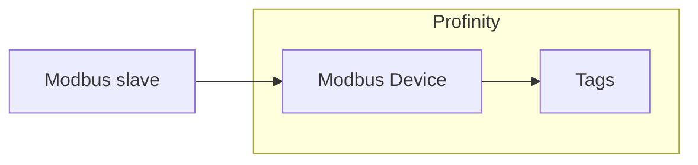

# Modbus

The **Modbus Device** component is a Modbus master.
It connects to one Modbus slave over Transmission Control Protocol (TCP) or over a serial line using Remote Terminal Unit (RTU) framing.

It polls the coils and registers you list in its point map and publishes each one as a Profinity tag.
Modbus is used for industrial devices and distributed input/output (I/O).
Profinity acts as a Modbus master only, not as a Modbus slave or server.

<figure markdown>

<figcaption>The Modbus Device component in Profinity polls the coils and registers in its point map from one Modbus slave and publishes each as a Profinity tag</figcaption>
</figure>

!!! info "Licence required"
    The Modbus plugin requires the **Industrial Protocols** licensed component group, and [Install an industrial protocol plugin](Install_an_Industrial_Protocol_Plugin.md) explains how to obtain, install, and licence it.

Add a Modbus Device to your [Profile](../../Getting_Started/Profiles.md) from the **Industrial Protocols** group in the component catalogue, as described in [How to add a component to your profile](../../How_To_Guides/Add_Component_to_Profile.md).
Add one component for each slave you want to read.
You can change the settings in the Communications settings section later from the component's **Change Settings** menu action.

## Quick start

You need a Modbus TCP slave that this computer can reach over the network, and its IP address. Viewing the dashboard requires the **Security administration** permission.

1. Select **ADD COMPONENT**, then select **Modbus Device** in the **Industrial Protocols** group.
2. Leave **Connection Mode** as **TCP**, and set **Host** to the IP address of the slave.
3. In the **Point map**, add one row with a **Name** and the **Address** of the register. Leave **Table** as **HoldingRegister** and **Data type** as **Word**.
4. Select **ADD COMPONENT** at the bottom of the dialog.
5. If **Auto Connect** is off, which is its default, select **Connect / Disconnect** from the component's menu to start polling.
6. On the component dashboard, check that **STATUS** shows **Connected** and **CONNECTED** is true.

## Communications settings

Which settings apply depends on the **Connection Mode**.

| Setting | Type | Default | Applies to | Description |
|---|---|---|---|---|
| **Name** | Text | `Modbus Device` | Both | The name of the component. Must be unique within the profile. |
| **Connection Mode** | Choice | `Tcp` | Both | `Tcp` or `Rtu`, shown as TCP or RTU in the UI. |
| **Host** | Text | `127.0.0.1` | TCP | The IP address of the slave. Required. |
| **Port** | Whole number | `502` | TCP | The TCP port. Between `1` and `65535`. |
| **Serial Port** | Text | Empty | RTU | The serial port the slave is connected to. Required for RTU. |
| **Baud Rate** | Whole number | `9600` | RTU | The serial baud rate. |
| **Parity** | Choice | `None` | RTU | The serial parity. |
| **Data Bits** | Whole number | `8` | RTU | `7` or `8`. |
| **Stop Bits** | Choice | `One` | RTU | The number of stop bits. |
| **Unit ID** | Whole number | `1` | Both | The Modbus unit (slave) address. Between `0` and `255`. |
| **Poll interval (ms)** | Time | `1000` | Both | How often the point map is read, in milliseconds. Between `50` and `600000`. |
| **Request timeout (ms)** | Time | `1000` | Both | How long Profinity waits for the slave to answer a request, in milliseconds. Between `50` and `60000`. |
| **Reconnect delay (ms)** | Time | `2000` | Both | How long Profinity waits between connection attempts, in milliseconds. Between `0` and `600000`. |
| **Auto Connect** | On or off | Off | Both | Connects automatically when the profile is loaded. Off by default, as described in [Connections and reconnecting](../Connections_and_Reconnecting.md#the-auto-connect-switch). |

With **Auto Connect** on, profinity keeps trying to connect when the device is down at start and after a connection is lost, as described in [Connections and reconnecting](../Connections_and_Reconnecting.md). With **Auto Connect** off, it connects only after you switch the component on.

Match the serial settings to those configured on the slave.
If they differ, the slave does not answer.

## Point map

The point map lists the coils and registers to read.
Each row becomes one tag.
This component has no **Browse** button, because a Modbus device does not publish a register list.
Folders are described in [Industrial protocol components](Industrial_Protocol_Components.md#point-map).

| Column | Description |
|---|---|
| **Name** | The name of the tag under the component's `Points` tags. It must be unique in its folder. The same name can be used in another folder. |
| **Table** | The Modbus table to read: `Coil`, `DiscreteInput`, `HoldingRegister` (the default) or `InputRegister`. |
| **Address** | The zero-based protocol address. Register `40001` in a one-based manufacturer's manual is address `0` of the holding registers. |
| **Data type** | How the value is decoded: `Boolean`, `Word` (the default), `SignedWord`, `Dword`, `SignedDword` or `Real`. |
| **Scale** | A factor that reads are multiplied by. Writes are divided by the same factor. The default is `1`. |
| **Writable** | Allows Profinity to write the value from the tag. Off by default. |
| **Unit** | An optional unit label for the tag. |

Registers are read as big-endian values.
`Word` and `SignedWord` use one register.
`Dword`, `SignedDword` and `Real` use two consecutive registers starting at the address, with the first register holding the high word.

The component has no word-swap option, so a device that sends the low word first returns wrong 32-bit values.
`Real` is a 32-bit floating point value.

Use **Scale** for devices that report fixed-point values.
For example, a temperature held as tenths of a degree uses a scale of `0.1`.

A `Coil` or `DiscreteInput` row always reads a single on/off bit, and its **Data type** is not used.
A `Boolean` row on a `HoldingRegister` or `InputRegister` table reads one register and is true when the register is not zero.

Only the `HoldingRegister` and `Coil` tables can be written.
`DiscreteInput` and `InputRegister` points are always read-only, even if **Writable** is on.

!!! warning "Writing to a device"
    Leave **Writable** off for any point that Profinity should only monitor, because a write changes the device.

## Example

This example is for illustration.
It reads a temperature held as tenths of a degree from a holding register, and switches a pump through a coil, on a Modbus TCP slave.
Add it under `components:` in the `profile.yaml` file of the profile.

```yaml
- component:
    type: ModbusDevice
    id: ModbusDevice1
    name: Pump Controller
    tagTreeParentPath: /
    connectionMode: Tcp
    host: SLAVE_IP_ADDRESS
    port: 502
    unitId: 1
    pollIntervalMilliseconds: 1000
    requestTimeoutMilliseconds: 1000
    reconnectDelayMilliseconds: 2000
    autoConnect: true
    points:
    - name: Temperature
      table: HoldingRegister
      address: 0
      dataType: Word
      scale: 0.1
      writable: false
      unit: °C
    - name: PumpRunning
      table: Coil
      address: 0
      writable: true
```

Replace `SLAVE_IP_ADDRESS` with the IP address of your Modbus slave.
Profinity fills in a missing or duplicate `id`, and a missing `tagTreeParentPath` (set to `/`), when it loads the profile, so you can leave them out. Set `name`, the connection settings and `points`. `type` names the component kind, so keep it as shown.
Each value is a setting from the [Communications settings](#communications-settings) or a column from the [Point map](#point-map).

## Dashboard

The component dashboard shows the connection **STATUS** (Connected or Disconnected) and whether the device is **CONNECTED**.
It also shows the number of values read (**RECEIVED**) and values written (**SENT**).
Use the **Connect / Disconnect** menu action to start or stop polling manually.
Viewing the dashboard requires the **Security administration** permission, described under [Roles and permissions](../../Administration/Users_and_Access/Roles_and_Permissions.md).

Polled values behave like any other tag, so they can be shown on a [dashboard](../Dashboard/Dashboard_Component.md), logged, watched by a rule, or read by a script.

## If a point shows bad quality

If a point cannot be read, its tag is marked as bad quality.
Check the usual causes in this table before reading the [Log](../../Administration/Logs_Config.md) for the reason.

| Cause | Fix |
|---|---|
| The **Address** is one higher or lower than the device manual states. | Use the zero-based protocol address. Register `40001` in a one-based manual is address `0` of the holding registers. |
| The **Unit ID** differs from the slave. | Set **Unit ID** to the slave's unit address. |
| The serial settings differ from the slave. | Match **Baud Rate**, **Parity**, **Data Bits** and **Stop Bits** to those configured on the slave. |
| The **Data type** does not match the register. | Choose the data type that matches the register. |

Refer to [Connections and reconnecting](../Connections_and_Reconnecting.md) for how the Log records failed reads and recovery.
