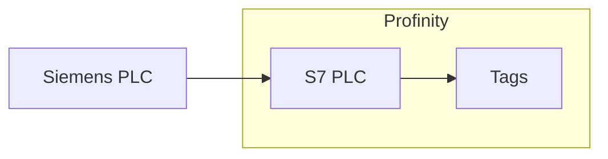

# S7

The **S7 PLC** component is an S7comm (Siemens S7 communication) client for Siemens programmable logic controllers (PLCs).
It connects to one PLC and polls the addresses you list in its point map, publishing each one as a Profinity tag.
It supports S7-300, S7-400, S7-1200, and S7-1500 controllers.
The S7 plugin requires the **Industrial Protocols** licensed component group, and [Install an industrial protocol plugin](Install_an_Industrial_Protocol_Plugin.md) explains how to obtain, install, and licence it.

<figure markdown>

<figcaption>The S7 PLC component in Profinity polls the addresses in its point map from one Siemens PLC and publishes each as a Profinity tag</figcaption>
</figure>

Add an S7 PLC to your [Profile](../../Getting_Started/Profiles.md) from the **Industrial Protocols** group in the component catalogue, as described in [How to add a component to your profile](../../How_To_Guides/Add_Component_to_Profile.md).
Add one component for each PLC you want to read.
You can change the settings in the Communications settings section later from the component's **Change Settings** menu action.

You specify the memory area and byte offset of each value.
Tags are addressed by memory area and byte offset, not by symbolic tag name.
For symbolic access to an S7-1200 or S7-1500, use the [OPC UA Client](OPC_UA_Client.md) against the PLC's Open Platform Communications Unified Architecture (OPC UA) server.

Before you add the component, prepare the PLC:

- Enable **Put/Get** access on S7-1200 and S7-1500 PLCs, which answer only when it is enabled.
- Use standard block access on data blocks, because optimised blocks cannot be read by absolute address.

Whoever maintains the PLC program changes both in the PLC's project, in the Siemens engineering software (TIA Portal).

## Quick start

You need the Industrial Protocols licensed component group, a PLC that the Profinity server can reach on the network, and Put/Get access enabled on an S7-1200 or S7-1500 PLC.

1. Add an **S7 PLC** from the **Industrial Protocols** group in the component catalogue.
2. Set **Host** to the IP address of the PLC. The default, `127.0.0.1`, is the loopback address of the local machine.
3. If the PLC is not an S7-1200, set **CPU type** to match it. The default is S7-1200.
4. Add one row to the **Point map** with a **Name** and an **Offset**, and set **Data type** to match the value. **Area** and **DB number** keep their defaults, DataBlock and 1.
5. If **Auto Connect** is off, which is its default, switch the component on with the **Connect / Disconnect** menu action.
6. On the component dashboard, check that **STATUS** shows **Connected** and **CONNECTED** is true. The tag for your row, under the component's `Points` tags, shows Good quality and its value.

## Communications settings

| Setting | Type | Default | Description |
|---|---|---|---|
| **Name** | Text | `S7 PLC` | The name of the component. Must be unique within the profile. |
| **Host** | Text | `127.0.0.1` | The IP address of the PLC. Required. |
| **Port** | Whole number | `102` | The Transmission Control Protocol (TCP) port. Between `1` and `65535`. |
| **Rack** | Whole number | `0` | The rack number of the PLC. Between `0` and `7`. |
| **Slot** | Whole number | `1` | The slot number of the CPU (central processing unit). Between `0` and `31`. |
| **CPU type** | Choice | `S7-1200` | The PLC family. The settings dialog lists `S7-300`, `S7-400`, `S7-1200` and `S7-1500`, and the profile file holds `S7300`, `S7400`, `S71200` or `S71500`, without the hyphen. |
| **Poll interval (ms)** | Time | `1000` | How often the point map is read, in milliseconds. Between `50` and `600000`. |
| **Request timeout (ms)** | Time | `1000` | How long Profinity waits for the PLC to answer a request, in milliseconds. Between `50` and `60000`. |
| **Reconnect delay (ms)** | Time | `2000` | How long Profinity waits between connection attempts, in milliseconds. Between `0` and `600000`. |
| **Auto Connect** | On or off | Off | Connects to the PLC automatically when the profile is loaded, as described in [Connections and reconnecting](../Connections_and_Reconnecting.md#the-auto-connect-switch). |

With **Auto Connect** on, profinity keeps trying to connect when the PLC is down at start and after a connection is lost, as described in [Connections and reconnecting](../Connections_and_Reconnecting.md). With **Auto Connect** off, it connects only after you switch the component on.

The usual rack and slot is `0` and `1` for S7-1200 and S7-1500 controllers, and `0` and `2` for most S7-300 controllers.
Confirm the values in the PLC's hardware configuration.

## Point map

The point map lists the PLC addresses to read.
Each row becomes one tag.
This component has no **Browse** button, because an S7 PLC does not publish the variables inside a data block.
Folders are described in [Industrial protocol components](Industrial_Protocol_Components.md#point-map).

| Column | Type | Default | Description |
|---|---|---|---|
| **Name** | Text | - | The name of the tag under the component's `Points` tags. It must be unique in its folder. The same name can be used in another folder. |
| **Area** | Choice | `DataBlock` | The memory area: `DataBlock`, `Memory` (M), `Input` (I) or `Output` (Q). |
| **DB number** | Whole number | `1` | The data block number. Used only when the area is `DataBlock`, and ignored otherwise. |
| **Offset** | Whole number | - | The byte offset within the selected area. |
| **Data type** | Choice | `Word` | How the value is read: `Boolean`, `Word`, `SignedWord`, `Dword`, `SignedDword` or `Real`. |
| **Writable** | On or off | Off | Allows Profinity to write the PLC value from the tag. |
| **Unit** | Text | - | An optional unit label for the tag. |

The data types map to the width of the value in the PLC, and to the type of the Profinity tag.

| Data type | Size | Profinity tag |
|---|---|---|
| `Boolean` | 1 bit (bit `0` of the byte) | Boolean |
| `Word` / `SignedWord` | 2 bytes (unsigned / signed) | Integer |
| `Dword` / `SignedDword` | 4 bytes (unsigned / signed) | Integer |
| `Real` | 4 bytes (floating point) | Number |

A `Boolean` point always reads bit `0` of the byte at its offset, because the point map has no bit number.
The PLC program must therefore place the value you need in bit `0` of a byte.
At offset 10, the address each point reads is, for example:

| Area and data type | Address read |
|---|---|
| `DataBlock` 1, `Boolean` | `DB1.DBX10.0` |
| `DataBlock` 1, `Word` | `DB1.DBW10` |
| `DataBlock` 1, `Dword` or `Real` | `DB1.DBD10` |
| `Memory`, `Word` | `MW10` |
| `Input`, `Word` | `IW10` |
| `Output`, `Word` | `QW10` |

Siemens tools set to German show the input and output areas as E and A rather than I and Q.

!!! warning "Writing to a PLC"
    A write can change the controlled process, so turn **Writable** on only for values that must be set from Profinity.

## Example

Add this example under `components:` in the `profile.yaml` file of the profile, and replace `PLC_IP_ADDRESS` with the IP address of your PLC.
The port, rack, slot, CPU type and timings are the defaults from the settings table, so change them only to suit your PLC.
The example sets **Auto Connect** on, so the component connects when the profile loads.

```yaml
- component:
    type: S7Plc
    id: S7Plc1
    name: Line 1 PLC
    tagTreeParentPath: /
    host: PLC_IP_ADDRESS
    port: 102
    rack: 0
    slot: 1
    cpuType: S71200
    pollIntervalMilliseconds: 1000
    requestTimeoutMilliseconds: 1000
    reconnectDelayMilliseconds: 2000
    autoConnect: true
    points:
    - name: Setpoint
      area: DataBlock
      dbNumber: 1
      offset: 10
      dataType: Real
      writable: false
```

This component reads the four bytes at `DB1.DBD10` once a second and publishes them as the Number tag `Setpoint` under the component's `Points` tags.

## Dashboard

The component dashboard shows the connection **STATUS** and whether the PLC is **CONNECTED**.
It also shows the number of values read (**RECEIVED**) and values written (**SENT**).
Use the **Connect / Disconnect** menu action to start or stop polling manually.
Viewing the dashboard requires the **Security administration** permission, described under [Roles and permissions](../../Administration/Users_and_Access/Roles_and_Permissions.md).

Polled values behave like any other tag, so they can be shown on a [dashboard](../Dashboard/Dashboard_Component.md), logged, watched by a rule, or read by a script.

## If a point shows bad quality

If a point cannot be read, its tag is marked as bad quality.
Check the usual causes in this table before reading the [Log](../../Administration/Logs_Config.md) for the reason.

| What you see | Cause | What to do |
|---|---|---|
| A point shows bad quality. | **Put/Get** access is disabled on the PLC. | Enable **Put/Get** access in the PLC's project. |
| A point shows bad quality. | A data block uses optimised block access. | Turn off optimised block access for the data block in the PLC's project. |
| A point shows bad quality. | **Rack** or **Slot** is wrong. | Set the values from the PLC's hardware configuration. |
| A point shows bad quality. | The PLC does not have the **DB number** or **Offset**. | Correct the point map row to an address that exists in the PLC. |

Refer to [Connections and reconnecting](../Connections_and_Reconnecting.md) for how the Log records failed reads and recovery.
