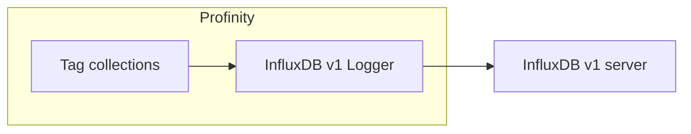
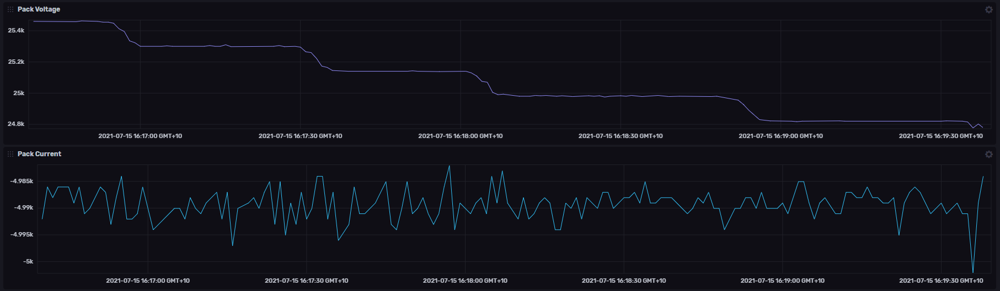

# InfluxDB v1 Logger

The **InfluxDB v1 Logger** sends the values of the [tags](../../Tags/index.md) in selected [tag collections](../../Tags/Collections/index.md) to an InfluxDB v1 server.
It sits in the **Loggers** group, and like every logger it only writes data out.
For an InfluxDB v2 or v3 server, use the **InfluxDB v2 Historian** or **InfluxDB v3 Historian**, described in [InfluxDB historians](../Historians/InfluxDB_Historians.md), which can also read the data back.

InfluxDB v1, v2, and v3 use different interfaces and sign-in methods, so a component for the wrong version cannot connect.
Check the version of your InfluxDB server before you add a component.
The [Loggers](index.md) page compares this logger with the others.

<figure markdown>

<figcaption>The InfluxDB v1 Logger sends the selected tag collections to an InfluxDB v1 server</figcaption>
</figure>

<figure markdown>

<figcaption>An InfluxDB dashboard showing pack voltage and pack current logged by Profinity</figcaption>
</figure>

## Quick start

You need a running InfluxDB v1 server and a database on it for the logger to write to, because the logger writes to an existing database.
If the server needs a sign-in, you also need its user name and password.

1. Select **ADD COMPONENT**.
2. Select **InfluxDB v1 Logger** in the **Loggers** group.
3. Set **InfluxDB Database** to the name of the database on the server.
4. Under **Collections**, add at least one tag collection whose tags you want to log.
5. If the server needs a sign-in, set **InfluxDB Username** and **InfluxDB Password**.
6. If the server is not at `http://localhost:8086/`, set **Influx Server URL** to its address.
7. Select **ADD COMPONENT**.
8. Check that **STATUS** shows **On**. If **Auto Connect** is off, select **Start Logger** from the component's menu first.

Data appears in the database after the first **Update Interval (Seconds)**, 10 seconds by default.

## Settings

| Setting | Type | Default | Effect |
|---|---|---|---|
| **InfluxDB Database** | Text | None | The database that the data is written to. Required. |
| **InfluxDB Username** | Text | Blank | The user name for a server that needs a sign-in. Leave it blank for a server without one. |
| **InfluxDB Password** | Secret | Blank | The password for a server that needs a sign-in. Leave it blank for a server without one. |
| **InfluxDB Retention Policy** | Text | `autogen` | The retention policy that the data is written with. |
| **Influx Server URL** | Text | `http://localhost:8086/` | The address of the InfluxDB server. |
| **Dashboard URL** | Text | Blank | The full address of an InfluxDB dashboard. When it is set, Profinity shows a link to it. |
| **InfluxDB Health Check** | On or off | On | Checks at regular intervals that the server answers. Turn it off for InfluxDB Cloud, where the logger reports that the health check failed. |
| **Collections** | Choice | None | The [tag collections](../../Tags/Collections/index.md) whose tags are logged. The logger needs at least one before it can start. The picker shows each collection's display name, and the profile stores its `id`. |
| **Update Interval (Seconds)** | Time | `10` | How often data is sent, from 1 to 86400 seconds. |
| **Logging mode** | Choice | `Snapshot` | What is sent on each interval: `Snapshot`, `On Change`, or `Everything`. Refer to [Logging modes](../Logging_Modes.md). |
| **Auto Connect** | On or off | On | Starts the logger when the profile loads. Refer to [Connections and reconnecting](../Connections_and_Reconnecting.md). |

## Example

Add this item under `components:` in the `profile.yaml` file of the profile.
Refer to [Profile folders](../../Administration/Profile_Folders.md) for where that file sits.

```yaml
- component:
    type: InfluxDbLoggerV1
    id: InfluxDbLoggerV11
    name: InfluxDB v1 Logger
    tagTreeParentPath: /
    bucket: YOUR_DATABASE
    url: http://localhost:8086/
    retentionPolicy: autogen
    healthCheck: true
    intervalSec: 10
    logType: Snapshot
    collections:
    - collectionName: YOUR_COLLECTION_ID
```

Replace `YOUR_DATABASE` with the InfluxDB database, which the profile stores under the `bucket` key, and `YOUR_COLLECTION_ID` with the `id` of a collection in the profile's `collections.yaml` file.
The example has no user name or password, which suits a server without a sign-in.

## What is stored

Profinity writes each sample as one point in a measurement named after the profile.
Spaces and other characters that are not letters or digits become underscores, so the profile `My Profile-2` writes to `My_Profile_2`.

Each point has these tags and fields.
The example is a motor speed signal on a component called `Inverter`.

| Part | Example | Meaning |
|---|---|---|
| Tag `profile` | `My_Profile_2` | The profile that wrote the sample. |
| Tag `component` | `Inverter` | The component that owns the tag. |
| Tag `message` | `Status` | The CAN message the signal belongs to. |
| Tag `signal` | `Speed` | The signal name. |
| Tag `full_tag_id` | `Inverter/DBC/Status/Speed` | The tag's path when the sample was written. |
| Field `value` | `23.4` | The reading. |
| Field `quality` | `Good` | The quality of the reading. |

Only tags that hold a number are written, and a query for readings asks for the `value` field.
A Good or Stale sample has a `value` field, and a Stale sample keeps its last value.
An Unavailable or Bad sample is written with a `quality` field and no `value`, so a chart shows a gap instead of an invented reading.

## Troubleshooting {#if-data-does-not-arrive}

| What you see | Cause | What to do |
|---|---|---|
| **STATUS** shows **Off** | No collection is selected, or **Auto Connect** is off. | Add a collection under **Collections**, or select **Start Logger** from the component's menu. |
| **STATUS** shows **Error** | The logger cannot reach the server, the database does not exist, or the sign-in is refused. Profinity writes the reason to the log once, then tries again every 5 seconds. | Read the reason on the [Logs](../../Administration/Logs_Config.md) page under **ADMIN**, then correct **Influx Server URL**, **InfluxDB Database**, or the sign-in. |
| **STATUS** shows **Error**, and the log says the health check failed | The server, such as InfluxDB Cloud, does not answer the health check. | Turn off **InfluxDB Health Check**. |
| **STATUS** shows **On**, but a tag has no readings in InfluxDB | The tag does not hold a number, or it is not in a selected collection. | Check the tag in **TAG EXPLORER**, and add it to one of the selected collections. |

To set up logging across a profile, refer to [How to configure data logging](../../How_To_Guides/Configure_Data_Logging.md).
To send data to InfluxDB Cloud, refer to [How to log data to InfluxDB](../../How_To_Guides/Log_Data_to_InfluxDB.md).
