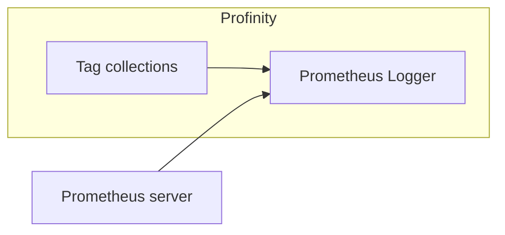

# Prometheus Logger

The **Prometheus Logger** publishes the values of the [tags](../../Tags/index.md) in selected [tag collections](../../Tags/Collections/index.md) at a web address that a [Prometheus](https://prometheus.io) server reads.
It sits in the **Loggers** group.

Prometheus collects data by calling the address on a schedule, which Prometheus calls scraping, so Profinity serves the latest values and Prometheus fetches them.
The [InfluxDB v1 Logger](InfluxDB_v1_Logger.md) works the other way round, and sends its data to the server.
To chart the data, pair Prometheus with a tool such as [Grafana](https://grafana.com).

<figure markdown>

<figcaption>The Prometheus Logger serves the selected tag collections, and a Prometheus server calls Profinity to read the latest values</figcaption>
</figure>

## Quick start

You need a [tag collection](../../Tags/Collections/index.md) that holds the tags to serve.

1. Select **ADD COMPONENT**, then select **Prometheus Logger** in the **Loggers** group.
2. Under **Collections**, select the collection. The logger needs at least one before it can start.
3. Keep **Server hostname** as `localhost`, **Server port** as `7065`, and **Data endpoint URL** as `metrics/`, which serve the data to Prometheus on this computer.
4. Select **ADD COMPONENT**. **Auto connect** is on by default, so the logger starts at once.
5. Check that **STATUS** shows **On**.
6. Open `http://localhost:7065/metrics` in a browser on this computer, and check that the page lists a line for each tag in the collection.

Then add `http://localhost:7065/metrics` to the scrape targets in your Prometheus configuration, as described in the [Prometheus documentation](https://prometheus.io/docs/).

## Settings

| Setting | Type | Default | Effect |
|---|---|---|---|
| **Collections** | Choice | None | The [tag collections](../../Tags/Collections/index.md) that are served. The logger needs at least one before it can start. |
| **Data endpoint URL** | Text | `metrics/` | The path of the address, after the host name and port, that serves the data. |
| **Server hostname** | Text | `localhost` | The host name or IP address that the address answers on. Refer to [Let another computer read the data](#let-another-computer-read-the-data). |
| **Server port** | Whole number | `7065` | The port of the address, from 1 to 65535. |
| **Dashboard URL** | Text | Blank | The full address of a Prometheus or Grafana dashboard. When it is set, Profinity shows a link to it. |
| **Update interval (seconds)** | Time | `10` | The seconds between samples, from 1 to 86400. |
| **Auto connect** | On or off | On | Starts the logger when the profile loads. When it is off, select **Start Logger** from the component's menu. Refer to [Connections and reconnecting](../Connections_and_Reconnecting.md). |

## Example

Add this item under `components:` in the `profile.yaml` file of the profile.
Refer to [Profile folders](../../Administration/Profile_Folders.md) for where that file sits.

```yaml
- component:
    type: PrometheusLogger
    id: PrometheusLogger1
    name: Prometheus Logger
    tagTreeParentPath: /
    hostname: localhost
    port: 7065
    url: metrics/
    intervalSec: 10
    collections:
    - collectionName: YOUR_COLLECTION_ID
```

Replace `YOUR_COLLECTION_ID` with the `id` of a collection in the profile's `collections.yaml` file.
With these values, Prometheus reads the data from `http://localhost:7065/metrics`.

## Let another computer read the data {#let-another-computer-read-the-data}

With **Server hostname** set to `localhost`, only Prometheus on the same computer can read the data.
For Prometheus on another computer, set **Server hostname** to the host name or IP address of the Profinity computer, or to `+` to answer on every address, and open **Server port** through any firewall between the two computers.

=== "Windows"

    Windows lets a program answer on an address other than `localhost` only when the address is reserved for its account, or when the program runs with administrator rights.
    To reserve it, run this command in an administrator PowerShell window:

    ```powershell
    netsh http add urlacl url=http://<host>:<port>/<path> user=<account>
    ```

    Replace `<host>` with **Server hostname**, such as `+`, `<port>` with **Server port**, `<path>` with **Data endpoint URL**, and `<account>` with the account that runs Profinity, such as `DOMAIN\user`.

=== "Linux and macOS"

    No reservation is needed. Restart the logger after you change **Server hostname**.

## What Prometheus receives

Profinity serves each tag in the selected collections as one gauge, a Prometheus value that can rise and fall.
The gauge name is the profile, component, message, and signal joined with underscores, and its labels identify the tag.
Characters other than letters and digits become underscores.

For example, a motor speed signal on a component called `Inverter`, in a profile called `MyProfile`, is served like this:

```text
# HELP MyProfile_Inverter_Status_Speed Inverter/DBC/Status/Speed
# TYPE MyProfile_Inverter_Status_Speed gauge
MyProfile_Inverter_Status_Speed{profile="MyProfile",component="Inverter",transmitter="",message="Status",signal="Speed",full_tag_id="Inverter_DBC_Status_Speed"} 23.4
```

The value is the latest reading of a tag with Good quality, and `NaN` for a tag with any other quality. The `transmitter` label is always empty.

## Troubleshooting

| What you see | Cause | What to do |
|---|---|---|
| **STATUS** shows **Error** | The logger cannot open its address, for example because another program uses the port. Profinity writes the reason to the log once, then tries again every 5 seconds. | Read the reason on the [Logs](../../Administration/Logs_Config.md) page under **ADMIN**, then free the port or change **Server port**. |
| **STATUS** shows **Off** | No collection is selected, or **Auto connect** is off. | Select a collection under **Collections**, or select **Start Logger** from the component's menu. |
| Prometheus shows no data, and the address works in a browser | The scrape target in Prometheus differs from the logger's address. | Set the Prometheus scrape target to the same host name, port, and path as **Server hostname**, **Server port**, and **Data endpoint URL**. |
| Prometheus on another computer cannot reach the address | **Server hostname** is `localhost`, the port is blocked, or on Windows the address is not reserved. | Follow [Let another computer read the data](#let-another-computer-read-the-data). |
| The address lists no tags | The selected collections hold no tags. | Add tags to the collection, or select another one. |

To set up logging across a profile, refer to [How to configure data logging](../../How_To_Guides/Configure_Data_Logging.md).
