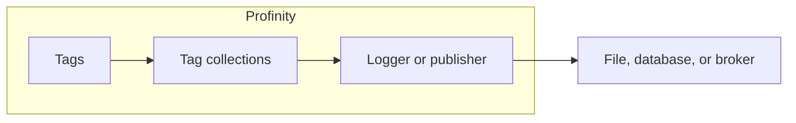

# Logging modes {#logging-modes}

The **Logging mode** setting decides which samples from the selected [tag collections](../Tags/Collections/index.md) a logger, historian, or publisher writes or sends.
The three modes are **Snapshot**, **On change**, and **Everything**.
**Snapshot** is the default on every component that offers the setting.

<figure markdown>

<figcaption>The logging mode on the logger or publisher selects which samples from the selected tag collections are written or sent</figcaption>
</figure>

## The three modes

- **Snapshot** reads the current value of every collection member once on each interval and writes or sends that value, whether or not it changed since the previous interval.
- **On change** records a sample only when a tag's value or quality changes, including the first sample, and holds those samples until the next flush.
- **Everything** records every sample a tag receives, including a repeat of the same value, and holds those samples until the next flush.

The difference between the modes is clearest with one worked case.
A tag updates once a second with the same reading, and the **Update interval (seconds)** is 10.

- **Snapshot** writes one row for that tag every 10 seconds: the value at the moment of the interval.
- **On change** writes a row on the first sample and then only when the value or quality changes.
- **Everything** writes about ten rows every 10 seconds: each sample that arrived in the interval, even though the value repeated.

**Snapshot** and **Everything** can both record an unchanged reading.
**Snapshot** takes that reading by polling current state on the interval.
**Everything** keeps every sample that arrived between flushes, so updates that happen inside the interval are not collapsed into one latest value.

**On change** and **Everything** are both driven by samples as they arrive, rather than by a periodic poll.
**On change** keeps only changes of value or quality.
**Everything** keeps every arrival.

## When to use each mode

**Snapshot** is the usual choice for a periodic record of the current state of a collection: dashboards, long-term historians, and routine file logs.
A shorter update interval increases how often that full state is written.

**On change** suits a history of real movement: when a value moved, when quality changed, and when a tag first gained a sample.
Quiet periods add no further rows.

**Everything** suits cases where the arrival of samples matters as much as the value, such as confirming that a source is still publishing while the reading is flat, keeping every sample timestamp for rate or forensic analysis, or feeding a consumer that expects each update.
It produces the largest volume of data.
Routine logging and publishing use **Snapshot** or **On change**.

## How the update interval applies

In **Snapshot** mode the interval is how often the current value of each member is read and written or sent.
In **On change** and **Everything** modes the interval is how often pending samples are flushed to the file, database, or destination.
The setting appears as **Update interval (seconds)** on the component pages that offer **Logging mode**.

## Components that offer logging modes

These components have a **Logging mode** setting:

- The **InfluxDB v1 Logger**, on [InfluxDB v1 Logger](Loggers/InfluxDB_v1_Logger.md).
- The **InfluxDB v2 Historian** and the **InfluxDB v3 Historian**, on [InfluxDB historians](Historians/InfluxDB_Historians.md).
- The Message Queuing Telemetry Transport (MQTT) Publisher, on [MQTT Publisher](Publishers_and_Subscribers/MQTT_Publisher.md).
- The **ThingsBoard Logger**, on [ThingsBoard Logger](Loggers/ThingsBoard_Logger.md).
- The **TAG File Logger** and the **TAG SFTP Logger** (Secure Shell (SSH) File Transfer Protocol), on [Tag file and SFTP loggers](Loggers/Tag_File_and_SFTP_Loggers.md).
- The **TAG Local Historian**, on [TAG Local Historian](Historians/TAG_Local_Historian.md).
- The **TAG SQL Historian**, on [TAG SQL Historian](Historians/TAG_SQL_Historian.md).
- The **Webhook Publisher**, on [Webhook Publisher](Publishers_and_Subscribers/Webhook_Publisher.md).

The **Tag Relay Sender** uses a separate **Mode** setting with **Snapshot** and **On change** only.
It has no **Everything** option, and in **On change** it also sends full snapshots on connect and on a resync interval so a rebooted receiver can rebuild tags that have not changed.
Refer to [Tag Relay Sender](Tag_Relays/Tag_Relay_Sender.md) for that mode and for **Snapshot / change interval (seconds)**.

To set the mode on a logger or publisher, refer to [How to configure data logging](../How_To_Guides/Configure_Data_Logging.md).
