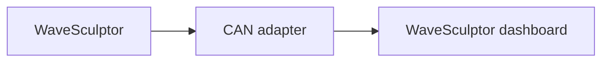

# WaveSculptor motor controller

The WaveSculptor dashboard monitors a Prohelion WaveSculptor22 or WaveSculptor200 motor controller.
It appears as a tab in the sidebar once the controller is added to the [Profile](../../../Getting_Started/Profiles.md).
The dashboard decodes the controller with the message and signal names of the CAN database (DBC) file, described on the [WaveSculptor22 DBC file](../../../../../Motor_Controllers/WaveSculptor22/User_Manual/DBC.md) page.

The WaveSculptor communicates only over CAN and takes its low-voltage supply from the CAN cable.
A [CAN adapter](../../CAN_Bus_Protocols/CAN_Bus_Adapters/index.md) connected to a powered CAN bus is therefore required before the dashboard shows any data.

<figure markdown>

<figcaption>The WaveSculptor sends CAN messages through a CAN adapter, and the WaveSculptor dashboard in the Profile decodes them</figcaption>
</figure>

The WaveSculptor22 component monitors both the WaveSculptor22 and the WaveSculptor200.
The two controllers send the same CAN messages with the same signals.
The WaveSculptor200 [DBC file](../../../../../Motor_Controllers/WaveSculptor200/User_Manual/DBC.md) matches the one the component uses.
Add the WaveSculptor22 component, whichever controller you have.

## Quick start

You need a CAN adapter connected to a powered CAN bus. The WaveSculptor takes its low-voltage supply from the CAN cable, and the dashboard shows no data without the adapter.

1. Add the **WaveSculptor22** component from the **Motor Controllers** group in the component catalogue, as described in [How to add a component to your profile](../../../How_To_Guides/Add_Component_to_Profile.md).
2. Check **Name**. The default is `WaveSculptor22`, and it must be unique in the profile.
3. Set **Base Address** to the address programmed into the controller, which you set in wsConfig as described in [Configure the WaveSculptor](Update_WaveSculptor_Configuration_and_Firmware.md#configure-the-wavesculptor). The default is `0x400`.
4. Select **ADD COMPONENT** at the bottom of the dialog.
5. Open the tab for the component in the sidebar, and check that **BUS VOLTAGE** and **BUS CURRENT** show values.

Profinity requests the settings in the following table when you add the WaveSculptor.
The **Change Settings** button on the dashboard changes them later.

| Parameter | Type | Description | Default |
|---|---|---|---|
| **Name** | Text | The name of the component. Must be unique. | WaveSculptor22 |
| **Milliseconds Valid** | Time | The timeout of the device, in milliseconds. Enter -1 for no timeout. | 5000 |
| **Base Address** | Hexadecimal | The CAN base address of the WaveSculptor, entered in hexadecimal. It must match the address programmed into the controller. | `0x400` |

If Profinity receives no traffic from the device within the **Milliseconds Valid** time, it treats the connection as lost.
Every WaveSculptor on the same CAN bus requires a different base address, as described in [CAN Bus and Low Voltage](../../../../../Motor_Controllers/WaveSculptor22/User_Manual/CAN_Bus_And_Low_Voltage.md).

Check these things if the dashboard shows no data.

| What you see | Cause | What to do |
|---|---|---|
| The dashboard shows no data. | Profinity receives no CAN traffic from the controller within **Milliseconds Valid**, so the connection is treated as lost. | Check that the CAN adapter status reads **Connected**, that the **Base Address** matches the address programmed into the controller, and that the baud rate of the CAN adapter in the Profile (for example **PCAN BaudRate**) matches the CAN bus data rate set in wsConfig (500 kbit/s is the factory default). |

## Tags

The component publishes each signal of its DBC file as a `DBC/<Message>/<Signal>` tag, and the `Properties/BusPower` tag, which is the bus voltage multiplied by the bus current.

## Example

This example is for illustration.
It adds a WaveSculptor with the CAN base address `0x60` (96 in decimal).
Add it under `components:` in the `profile.yaml` file of the profile.

```yaml
- component:
    type: ProhelionWaveSculptor22
    id: ProhelionWaveSculptor221
    name: Prohelion WaveSculptor 22 - Left
    tagTreeParentPath: /
    milliValid: 5000
    baseAddress: 96
```

Use a different `id` and **Base Address** for each WaveSculptor on the same CAN bus.

The [WaveSculptor dashboard](WaveSculptor_Dashboard.md) page describes the data, limit indicators and error indicators.
To configure the controller or flash its firmware, refer to [Update WaveSculptor configuration and firmware](Update_WaveSculptor_Configuration_and_Firmware.md).
