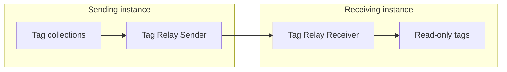

# Tag Relay Receiver

The **Tag Relay Receiver** receives the tags sent by one or more [Tag Relay Senders](Tag_Relay_Sender.md) on other Profinity instances.
It mounts them as read-only [tags](../../Tags/index.md) under a prefix that identifies where they came from.
It sits in the **Tag Relays** category and receives over Message Queuing Telemetry Transport (MQTT) or HTTPS.
It applies every update a sender sends, whether a full snapshot or the value changes that a sender in On change mode sends between snapshots.

Relayed tags can be read like any local tag.
You can browse them in **Tag Explorer**, place them in [collections](../../Tags/Collections/index.md), show them on a [dashboard](../../Customising_Profinity/Dashboards/index.md), log them, and use them in rules and scripts.
The [Tag relay](../../Tags/Tag_Relay.md) page explains the concept, shows a fleet of sites relaying to one central instance, and sets out the collision rules.

<figure markdown>

<figcaption>The Tag Relay Sender in the sending instance sends a snapshot of its tag collections to the Tag Relay Receiver in the receiving instance, directly over HTTPS or through an MQTT broker, and the receiver mounts them as read-only tags</figcaption>
</figure>

!!! info "Licence required"
    The Tag Relay Receiver requires the **Data Relay** licensed feature. Refer to [Licensing](../../Licensing.md) for the editions that include it.

## Quick start {#adding-a-tag-relay-receiver}

To set up a sender and a receiver together for the first time, refer to [Set up a tag relay](Set_Up_a_Tag_Relay.md).

1. Select **ADD COMPONENT** on the homepage or at the bottom of the sidebar, then choose **Tag Relay Receiver** from the **Tag Relays** category. See [How to add a component to your profile](../../How_To_Guides/Add_Component_to_Profile.md).
2. Set **Protocol** to the same protocol as the sender, **HTTPS** or **MQTT**.
3. Set a **Receiver tag path prefix** that sits in its own subtree, outside the tag path of any component and of any other receiver's prefix.
4. Enter the settings for your protocol.
   For MQTT, enter the **MQTT broker URL** and **MQTT subscribe topic** from [MQTT settings](#mqtt-settings).
   For HTTPS, follow [Receiving over HTTPS](#receiving-over-https).
5. Save the settings.
   Saving restarts the receiver.
   An MQTT receiver starts when the profile loads if **Auto connect** is on. Otherwise it stays **Off** until you turn on the **Connect / Disconnect Toggle** on its component dashboard.
   Otherwise its status shows **Off**, and you turn the toggle on.
   A receiver set to HTTPS starts running without a start step.

To check that it works, wait for the sender's next update and open **Tag Explorer**.
The relayed tags appear under the **Receiver tag path prefix**.

## Settings

### Tag Relay settings

| Setting | Type | Default | Purpose |
|---|---|---|---|
| **Protocol** | Choice of **HTTPS** or **MQTT** | **HTTPS** | With **HTTPS**, the sender posts each update straight to this instance, so every connection starts at the sender. With **MQTT**, the receiver subscribes to a topic on a broker and applies each update it receives. Set it to match the sender's **Protocol**. |
| **Receiver tag path prefix** | Text | None | Required. The profile subtree that receives every update from the sender. It sits outside the tag path of every component and the prefix of every other receiver in the profile, and the check ignores case. The sender's **Sender tag path prefix** is added beneath it. Refer to [Tag tree paths and dashboard binds](../../Tags/Selecting_Tags/Tag_Tree_Path.md). |

### MQTT settings

| Setting | Type | Default | Purpose |
|---|---|---|---|
| **Auto connect** | On or off | On | Connects to the broker when the profile loads. Refer to [Connections and reconnecting](../Connections_and_Reconnecting.md). |
| **MQTT broker URL** | URL starting `mqtt://`, `mqtts://`, `http://` or `https://` | None | Required for MQTT. The broker's connection URL. Use `mqtts://` for Transport Layer Security (TLS). |
| **MQTT broker port** | Whole number, 1 to 65535 | `1883` | The broker's port. A port in the broker URL takes precedence. With an `mqtts://` URL that has no port, leaving this at `1883` connects on `8883`. |
| **Trust all server certificates** | On or off | Off | Accepts the broker's TLS certificate without validating it. Turn it on only for a trusted broker that uses a self-signed certificate. |
| **MQTT username** | Text | None | Optional. The user name for a broker that requires authentication. |
| **MQTT password** | Secret | None | Optional. The password for a broker that requires authentication. It is stored encrypted. |
| **MQTT client id** | Text | None | Optional. Leave blank to generate a client ID. Each client on the broker needs a different ID. |
| **MQTT subscribe topic** | Text | None | Required for MQTT. The topic the sender publishes to, for example `profinity/relay/site1`. It matches the sender's **MQTT snapshot topic**. Profinity checks it when the receiver starts. |

### Receiving over HTTPS

With **HTTPS**, the sender posts each update straight to this instance, with a token for a user that holds the **Receive external tags** permission.
The default Administrators role holds it.
A [service account](../../Administration/Users_and_Access/Service_Accounts.md) is a user account for automation that signs in with a long-lived token instead of a password.
Use a service account token, so the relay keeps working without anyone signing in.

1. On this instance, create a service account with a role that holds the **Receive external tags** permission.
   Refer to [Roles and permissions](../../Administration/Users_and_Access/Roles_and_Permissions.md) for how to grant it.
2. On the **User Actions** tab of the account, select **Generate Token**.
   The **Service account token** dialog shows the token.
3. Enter the token in the sender's **Bearer token**.

An instance accepts relayed updates for one Tag Relay Receiver set to HTTPS, so add a single HTTPS receiver per instance.
That receiver sets the **Receiver tag path prefix** and shows the receiving status.
For the routes the sender posts to, refer to Tag Relay in the [Endpoint Reference](../../Integrating_to_Profinity/APIs/Endpoint_Reference.md#tag-relay).

## Relayed tags

The receiver mounts each relayed tag beneath the **Receiver tag path prefix**, followed by the sender's **Sender tag path prefix** when the sender has one.
With a receiver prefix of `Fleet` and a sender prefix of `Vehicle12`, the tags appear at `Fleet/Vehicle12/...`.
When the broker drops a running MQTT receiver, the relayed tags keep their last value and show **Stale** until the sender's next snapshot arrives.

!!! info "Relayed tags are read-only"
    A tag created by the receiver is read-only.
    Only the next update from the sender changes its value.
    A path already used by a tag that relay does not own, such as a local device tag, causes the whole update to be rejected.
    Refer to [Collision rules](../../Tags/Tag_Relay.md#collision-rules).

## Example

This example configures a receiver that subscribes to a broker and mounts the relayed tags under `SiteA`.
Add it to the `components` list in `profile.yaml`, or enter the same values in the component settings.

```yaml
- component:
    type: TagRelayReceiver
    id: TagRelayReceiver1
    name: Tag Relay Receiver
    tagTreeParentPath: /
    protocol: Mqtt
    autoConnect: true
    receiverTagPathPrefix: SiteA
    mqttBrokerUrl: mqtt://BROKER_HOST
    mqttBrokerPort: 1883
    mqttSubscribeTopic: profinity/relay/site1
```

Replace `BROKER_HOST` with the host name or address of your MQTT broker.
The `mqttSubscribeTopic` value matches the **MQTT snapshot topic** of the sender.

After the profile loads, the receiver's status shows **On**.
Once the broker is reachable and the sender's next snapshot arrives, the relayed tags appear under `SiteA` in **Tag Explorer**.

## Monitoring the receiver

The status shows **On** while the receiver is running and **Off** when it is stopped.
**On** means the receiver is running, and does not confirm that the broker connection is up.
Its component dashboard shows the **STATUS** and **MESSAGES RECEIVED** values and a chart of messages received per second.
To start a stopped MQTT receiver, turn on the **Connect / Disconnect Toggle** on its component dashboard.

If the receiver shows **On** but receives nothing, check the [**Logs**](../../Administration/Logs_Config.md) for a broker error.
The first failed connection to the broker appears as an error.
A snapshot that cannot be applied is logged differently from a broker outage.
Each snapshot that is not valid JSON, has the wrong format, or conflicts with an existing tag is logged as its own warning, so the warning repeats for as long as the problem lasts.

## Troubleshooting

If no tags appear, check the [**Logs**](../../Administration/Logs_Config.md) first.

| What you see | Cause | What to do |
|---|---|---|
| Saving reports `Receiver Tag Path is required.` | The **Receiver tag path prefix** is empty. | Enter a prefix. |
| Saving reports `Tag destination '<a>' overlaps '<b>'. Choose a unique destination.` | The prefix equals, contains, or sits inside the tag path of a component or the prefix of another receiver. | Choose a prefix in its own subtree. |
| Saving reports `You must provide an MQTT broker URL when using MQTT.` | The protocol is MQTT and the **MQTT broker URL** is empty. | Enter the **MQTT broker URL**. |
| An MQTT receiver stays **Off**, and the log shows `Tag Relay Receiver: MQTT requires broker URL and subscribe topic.` | The **MQTT subscribe topic** is empty. | Enter the **MQTT subscribe topic**, save, and turn on the **Connect / Disconnect Toggle**. |
| The receiver shows **On** but receives nothing, and the log shows a broker connection error. | The receiver cannot reach the broker. It retries every 5 seconds. | Check the broker URL, port, credentials, and TLS settings. Refer to [Connections and reconnecting](../Connections_and_Reconnecting.md). |
| The receiver shows **On** but receives nothing, and the log shows no broker error. | The **MQTT subscribe topic** differs from the sender's **MQTT snapshot topic**. | Set the **MQTT subscribe topic** to match the sender's **MQTT snapshot topic**. |
| Relayed tags show **Stale**. | The broker dropped the receiver, and the tags keep their last value. | Restore the broker connection. The tags update when the sender's next snapshot arrives. |
| Over MQTT, the tags stop updating, and the log shows `Tag relay MQTT ingest conflict; batch rejected.` for every snapshot. | A path in the snapshot [collides](../../Tags/Tag_Relay.md#collision-rules) with an existing tag, such as a local tag at the same path, so the receiver rejects the whole snapshot. | Delete the local tag at that path in the [Derived Tags](../../Tags/Derived_Tags/index.md) editor if it is a derived tag, or change the **Receiver tag path prefix** or the sender's **Sender tag path prefix** so that the relayed tags mount in an empty subtree. |
| Over HTTPS, the sender receives a 409 response with `A non-relay tag already exists at '<id>'.` or another collision message. | A path in the snapshot collides with an existing tag, so the receiver rejects the whole snapshot. | Delete the local tag at that path in the [Derived Tags](../../Tags/Derived_Tags/index.md) editor if it is a derived tag, or change one of the prefixes so that the relayed tags mount in an empty subtree. |
| Over HTTPS, the sender receives a 409 response with `Multiple active HTTPS Tag Relay Receivers make the receiver prefix ambiguous.` | More than one Tag Relay Receiver set to HTTPS is active on this instance. | Keep a single HTTPS receiver on the instance. |
| Over HTTPS, the sender receives a 401 or 403 response. | The token is missing or invalid, or its user lacks the **Receive external tags** permission. | Give the sender a service account token with the **Receive external tags** permission, as in [Receiving over HTTPS](#receiving-over-https). |
| Over HTTPS, the sender receives a 400 response. | The update is malformed, or its body is over 5 MB. | Select fewer tags in the sender's collections, so that each snapshot is 5 MB or smaller. |
| Tags from an HTTPS sender appear at the top of the tag tree, outside the **Receiver tag path prefix**. | No Tag Relay Receiver on this instance is set to **HTTPS**, so no prefix applies. | Set the receiver's **Protocol** to **HTTPS**. |
| Over HTTPS, the sender receives a 429 response with `Too many relay requests.` | The same user and client address sent more than 120 requests in one minute. | Lengthen the sender's interval, so that it posts fewer than 120 times a minute. |
| Over HTTPS, the sender receives a 503 response. | This instance has not finished loading its tag tree. | Wait for the instance to finish loading, then check that the sender's next update arrives. |

To connect a sender to this receiver end to end, refer to [Set up a tag relay](Set_Up_a_Tag_Relay.md).
