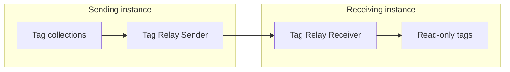

# Tag Relay Sender

The **Tag Relay Sender** sends the [tags](../../Tags/index.md) in the [collections](../../Tags/Collections/index.md) you select to a [Tag Relay Receiver](Tag_Relay_Receiver.md) on another Profinity instance.
It sits in the **Tag Relays** category and sends over HTTPS or Message Queuing Telemetry Transport (MQTT).
It sends the tags in one of two modes, described under **Mode** in [Tag Relay settings](#tag-relay-settings).
The [Tag relay](../../Tags/Tag_Relay.md) page explains the concept and shows a fleet of sites relaying to one central instance.

<figure markdown>

<figcaption>The Tag Relay Sender in the sending instance sends a snapshot of its tag collections to the Tag Relay Receiver in the receiving instance, directly over HTTPS or through an MQTT broker, and the receiver mounts them as read-only tags</figcaption>
</figure>

!!! info "Licence required"
    The Tag Relay Sender requires the **Data Relay** licensed feature. Refer to [Licensing](../../Licensing.md) for the editions that include it.

## Quick start {#adding-a-tag-relay-sender}

To set up a sender and a receiver together for the first time, refer to [Set up a tag relay](Set_Up_a_Tag_Relay.md).

The sender sends only the member tags of the collections you select, so first create at least one collection in the profile that holds the tags to send.
For HTTPS, have the **Remote base URL** and **Bearer token** for the receiving instance ready.
For MQTT, have the **MQTT broker URL** and **MQTT snapshot topic** ready.

1. Add a **Tag Relay Sender** to your profile from the **Tag Relays** category.
2. Set **Protocol** to the same protocol as the receiver, **HTTPS** or **MQTT**.
3. Under **Collections**, add one or more collections to send.
4. Enter the settings for your protocol, from [HTTPS settings](#https-settings) or [MQTT settings](#mqtt-settings).
5. Save the settings.
   Saving restarts a running sender.
   If its status shows **Off**, turn on the **Start Sender / Stop Sender Toggle** on its component dashboard.

To check that it works, wait for one **Snapshot / change interval (seconds)**.
The total messages sent on the component dashboard has increased.

## Settings

### Tag Relay settings

| Setting | Type | Default | Purpose |
|---|---|---|---|
| **Protocol** | Choice of **HTTPS** or **MQTT** | **HTTPS** | With **HTTPS**, the sender sends the data straight to the remote instance. With **MQTT**, it publishes the data to a topic on a broker. Set it to match the receiver's **Protocol**. |
| **Sender tag path prefix** | Text | None | Optional. Path segments added in front of the sent tags, beneath the receiver's **Receiver tag path prefix**. Refer to [Relayed tags](Tag_Relay_Receiver.md#relayed-tags) for an example. |
| **Exclude relay-managed nodes** | On or off | On | Skips tags that this instance itself received through a Tag Relay, so that mirrored data is not sent on again in a loop. |
| **Mode** | Choice of **Snapshot** or **On Change** | **Snapshot** | **Snapshot** sends every tag in the collections at each interval. **On Change** sends changed values between full snapshots, as described after this table. |
| **Snapshot / change interval (seconds)** | Whole number of seconds, 5 to 86400 | `60` | In Snapshot mode, how often a full snapshot is sent. In On Change mode, how often changed values are sent. |
| **Resync interval (seconds)** | Whole number of seconds, 5 to 86400 | `300` | On Change mode only. How often a full snapshot is sent again. It must be at least the **Snapshot / change interval (seconds)**. |
| **Auto Connect** | On or off | On | Starts the sender when the profile loads. When it is off, start the sender with **Start Sender**. Refer to [Connections and reconnecting](../Connections_and_Reconnecting.md). |
| **Collections** | List of collections | None | Required. The profile collections whose member tags the sender sends. The picker shows display names, with the group path where the collection sits in a group. |

In On Change mode, the sender sends a full snapshot when it connects and each time it reconnects.
Between snapshots, it sends the changed values at each **Snapshot / change interval (seconds)** as a delta, which is a list of changed values only.
At each **Resync interval (seconds)**, it sends a full snapshot again, so that a receiver that has restarted can rebuild the tags that have not changed.
Every full snapshot includes tag metadata such as units, and the receiver accepts both modes.

### HTTPS settings

| Setting | Type | Default | Purpose |
|---|---|---|---|
| **Remote base URL** | Text | None | Required for HTTPS. The base address of the receiving instance, for example `https://receiver:443/`. Profinity adds the path it sends to. |
| **Bearer token** | Secret | None | Required for HTTPS. A token for a user on the receiving instance who holds the **Receive external tags** permission, such as a member of the default Administrators role. Use the token of a [service account](../../Administration/Users_and_Access/Service_Accounts.md), so that the relay keeps working without anyone signing in. Refer to [Receiving over HTTPS](Tag_Relay_Receiver.md#receiving-over-https). It is stored encrypted. |
| **Trust all server certificates** | On or off | Off | Accepts the receiving instance's Transport Layer Security (TLS) certificate without validating it. Turn it on only for a trusted receiver that uses a self-signed certificate. |

### MQTT settings

| Setting | Type | Default | Purpose |
|---|---|---|---|
| **MQTT broker URL** | URL starting `mqtt://`, `mqtts://`, `http://` or `https://` | None | Required for MQTT. The broker's connection URL. Use `mqtts://` for TLS. |
| **MQTT broker port** | Whole number, 1 to 65535 | `1883` | The broker's port. A port in the broker URL takes precedence. With an `mqtts://` URL that has no port, leaving this at `1883` connects on `8883`. |
| **Trust all server certificates** | On or off | Off | Accepts the broker's TLS certificate without validating it. Turn it on only for a trusted broker that uses a self-signed certificate. |
| **MQTT username** | Text | None | Optional. The user name for a broker that requires authentication. |
| **MQTT password** | Secret | None | Optional. The password for a broker that requires authentication. It is stored encrypted. |
| **MQTT client id** | Text | None | Optional. Leave blank to generate a client ID. Each client on the broker needs a different ID. |
| **MQTT snapshot topic** | Text | None | Required for MQTT. The topic that carries the snapshots and changes, for example `profinity/relay/site1`. The receiver's **MQTT subscribe topic** must match it. |

## Example

This example configures a sender that publishes one collection to a broker every 60 seconds in Snapshot mode.
Add it to the `components` list in `profile.yaml`, or enter the same values in the component settings.

```yaml
- component:
    type: TagRelaySender
    id: TagRelaySender1
    name: Tag Relay Sender
    tagTreeParentPath: /
    protocol: Mqtt
    mode: Snapshot
    snapshotIntervalSeconds: 60
    autoConnect: true
    mqttBrokerUrl: mqtt://BROKER_HOST
    mqttBrokerPort: 1883
    mqttSnapshotTopic: profinity/relay/site1
    collections:
    - collectionName: COLLECTION_ID
```

Replace `BROKER_HOST` with the host name or address of your MQTT broker.
Replace `COLLECTION_ID` with the id of a collection that exists in the profile.
The receiver's **MQTT subscribe topic** matches the `mqttSnapshotTopic` value.

After the profile loads, the sender's status shows **On**.
Once the broker is reachable, the total messages sent on its component dashboard rises after one interval.

## Monitoring the sender

The status shows **On** while the sender is running and **Off** when it is stopped.
Over MQTT, it shows **Error** while the sender is running but its connection to the broker is failing.
**On** means the sender is running, and does not confirm that the last snapshot was delivered over HTTPS.
Its component dashboard shows the **STATUS** and **MESSAGES SENT** values and a chart of messages sent per second, and the total rises each time a snapshot or delta is delivered.

To start or stop the sender, use the **Start Sender / Stop Sender Toggle** on its component dashboard, or the **Start Sender** and **Stop Sender** actions.
Saving the settings of a running sender stops it and starts it again.

When a send fails, the [**Logs**](../../Administration/Logs_Config.md) show a warning for the first failure of the outage, such as `<name>: HTTPS send failed (<status>: <body>).` or `<name>: MQTT publish failed (<reason>).`, where `<name>` is the name of the sender.
Later failures in the same outage are logged at debug level only.
When sending recovers, the Logs show `<name>: working again.`

## Troubleshooting

If the sender stays **Off**, or its total messages sent stops rising, check the [**Logs**](../../Administration/Logs_Config.md) first.
The sender logs the reason each time it refuses to start, and the HTTPS status code appears in the warning for a failed send.

| What you see | Cause | What to do |
|---|---|---|
| The sender stays **Off**, and the log shows `Tag Relay Sender: At least one collection must be configured.` | No collection is selected. | Select at least one collection under **Collections**. |
| The sender stays **Off**, and the log shows `Tag Relay Sender: Unknown collection '<name>'.` or starts `Tag Relay Sender: Profile collections file was not found.` | A selected collection does not exist in the profile. | Create the collection, or select a collection that exists in the profile. |
| The sender stays **Off**, and the log shows `Tag Relay Sender: HTTPS requires Remote base URL.` or `Tag Relay Sender: HTTPS requires Bearer token.` | The protocol is HTTPS, and the **Remote base URL** or **Bearer token** is empty. | Enter the **Remote base URL** and **Bearer token**, save, and turn on the **Start Sender / Stop Sender Toggle**. |
| The sender stays **Off**, and the log shows `Tag Relay Sender: MQTT requires broker URL.` or `Tag Relay Sender: MQTT requires snapshot topic.` | The protocol is MQTT, and the **MQTT broker URL** or **MQTT snapshot topic** is empty. | Enter the **MQTT broker URL** and **MQTT snapshot topic**, save, and turn on the **Start Sender / Stop Sender Toggle**. |
| The sender stays **Off**, and the log shows `Tag Relay Sender: Resync interval must be at least the snapshot / change interval.` | The mode is On Change, and the **Resync interval (seconds)** is shorter than the **Snapshot / change interval (seconds)**. | Set the **Resync interval (seconds)** to at least the **Snapshot / change interval (seconds)**. |
| The sender shows **Error**, and the log shows `Tag Relay Sender MQTT disconnected (<reason>); reconnecting.` or a broker connection error. | The sender cannot reach its MQTT broker. It retries every second, and logs the first failed connection of the outage as an error. | Check the **MQTT broker URL**, **MQTT broker port**, credentials, and TLS settings. Refer to [Connections and reconnecting](../Connections_and_Reconnecting.md). |
| Over HTTPS, the log shows `Tag Relay Sender publish cycle failed.` at each interval. | The sender cannot reach the receiving instance, for example because of a name lookup, connection, or certificate failure. | Check the **Remote base URL**. Turn on **Trust all server certificates** only for a trusted receiver that uses a self-signed certificate. |
| Over HTTPS, the warning shows `HTTPS send failed (401: <body>)` or `HTTPS send failed (403: <body>)`. | The token is missing or invalid, or its user does not hold the **Receive external tags** permission. | Enter a service account token whose user holds the **Receive external tags** permission, as in [Receiving over HTTPS](Tag_Relay_Receiver.md#receiving-over-https). |
| Over HTTPS, the warning shows `HTTPS send failed (409: <body>)`. | A path in the snapshot [collides](../../Tags/Tag_Relay.md#collision-rules) with a tag that relay does not own, or more than one Tag Relay Receiver set to HTTPS is active on the receiving instance. | Match the message in the warning to the 409 rows in the [Tag Relay Receiver troubleshooting](Tag_Relay_Receiver.md#troubleshooting), and follow the fix there. |
| Over HTTPS, the warning shows `HTTPS send failed (400: <body>)`. | The update is malformed, or its body is over 5 MB. | Select fewer tags or fewer collections, so that each snapshot is 5 MB or smaller. |
| The sender receives `400 Bad Request`. | The snapshot is malformed, or its `version` is not 2.3. A Profinity 2.3 Tag Relay Sender sets `version` itself, so this applies to a snapshot from another publisher or release. | Set `version` to "2.3" in each snapshot. |
| Over HTTPS, the warning shows `HTTPS send failed (429: <body>)`, and the body contains `Too many relay requests.` | The same user and client address sent more than 120 requests in one minute. | Lengthen the **Snapshot / change interval (seconds)**. |
| Over HTTPS, the warning shows `HTTPS send failed (503: <body>)`. | The receiving instance has not finished loading its tag tree. The sender keeps trying at each interval. | Wait for the receiving instance to finish loading, then check that the total messages sent rises. |
| Over MQTT, the warning shows `MQTT publish failed (<reason>)`. | The broker refused the message, for the reason code and text that it returns, which the warning shows. | Check the **MQTT broker URL**, **MQTT broker port**, **MQTT username**, and **MQTT password** against the reason in the Logs. If those are right, check the broker's own rules for the topic, such as which users may publish to it. |
| Over HTTPS, the total messages sent rises, and the tags appear at the top of the receiving instance's tag tree under the **Sender tag path prefix**. | The receiving instance has no Tag Relay Receiver set to **HTTPS**, so no **Receiver tag path prefix** applies. | Add a Tag Relay Receiver set to **HTTPS** on the receiving instance, and set its **Receiver tag path prefix**. |
| Over MQTT, the total messages sent rises, but no tags appear on the receiver. | The receiver's **Protocol** is **HTTPS**, or its **MQTT subscribe topic** differs from the **MQTT snapshot topic**. | Set the receiver's **Protocol** to **MQTT**, and its **MQTT subscribe topic** to the **MQTT snapshot topic**. |

To connect a sender to a receiver end to end, refer to [Set up a tag relay](Set_Up_a_Tag_Relay.md), and for the settings at the receiving end, refer to [Tag Relay Receiver](Tag_Relay_Receiver.md).
