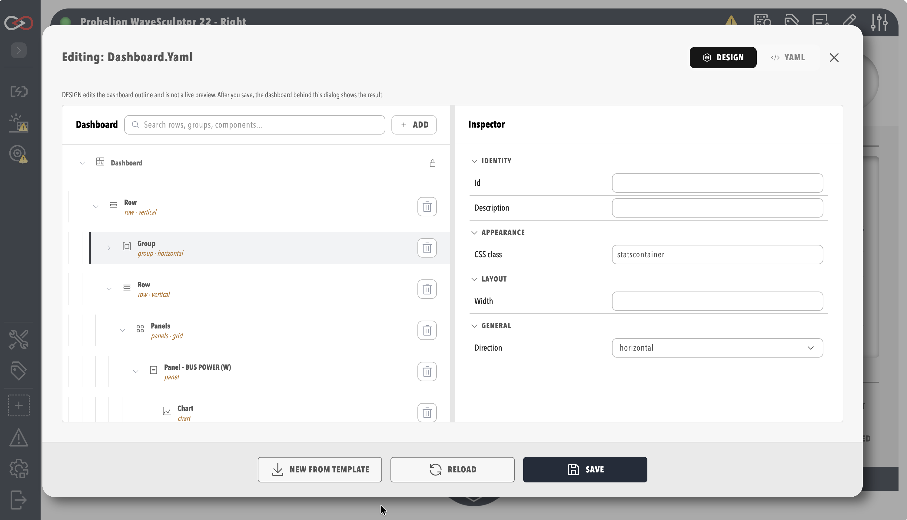
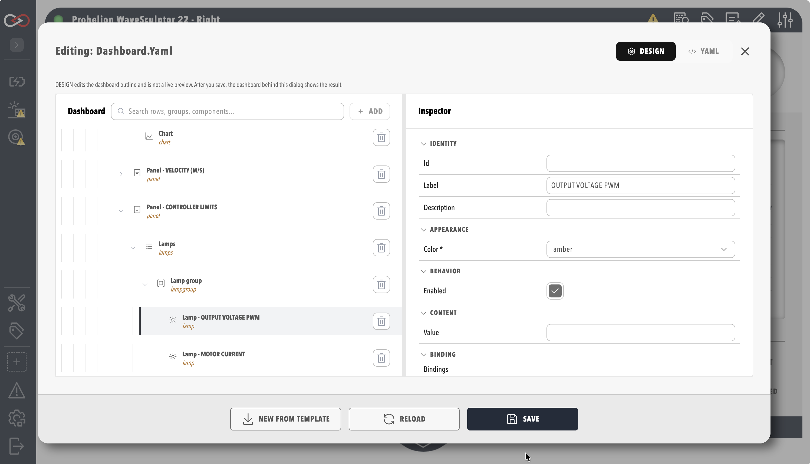

# Build a dashboard in the Visual Editor

Use these steps to build or change a dashboard in the Visual Editor, bind its elements to tags and save it.
You need the **Modify dashboards** permission, which an administrator grants in a role as described in [Roles and permissions](../../Administration/Users_and_Access/Roles_and_Permissions.md).
The **Edit Dashboard** icon is shown only to users with that permission.

Many dashboard values are bound to a tag, so familiarity with the [Tag Explorer](../../Tags/index.md) helps.
A basic understanding of YAML syntax is needed only when you use the **YAML** tab or read the examples in this guide.
For the parts of the editor, refer to the [Visual Editor reference](./Visual_Editor.md).

## Open the Visual Editor

1. Open a component that uses a custom dashboard, or open the home page if the profile uses a home dashboard, as described in [Profile dashboard](../../Administration/Profile_Dashboard.md).
2. Select the pencil (**Edit Dashboard**) icon in the menu at the right of the dashboard title bar.

The editor opens in **DESIGN** mode, which is the Visual Editor.

<figure markdown>

<figcaption>Dashboard Visual Editor</figcaption>
</figure>

## Add and arrange elements

1. In the dashboard tree, select the container to add into, such as a row, group, or pill. Leave the dashboard root selected to add at the top level.
2. Select **Add**. The **Add component** window lists the element types that fit the selection, such as Row, Group, Pill, Readout, Lamp, Chart, and Action.
3. Choose a type. The new element appears in the tree as the first child of the selected container, and it is selected. With the dashboard root selected, it appears at the top of the dashboard.
4. Drag the new element in the tree to its final position. The tree shows a drop position only where the dashboard schema permits one.
5. In the **Inspector**, set the properties of the element.

Each property in the inspector uses the control that suits it, as listed in the [Visual Editor reference](./Visual_Editor.md#inspector).

To delete an element:

1. In the dashboard tree, select the trash (**Delete**) icon on the row of the element.
   The root row has no **Delete** icon.
2. Confirm the deletion in the **Delete element** dialog by selecting **Delete**. The dialog states how many nested elements are removed with it.

The element and its nested elements disappear from the tree.
The deletion takes effect when you save, so to undo it, close the editor without saving and confirm that the changes are discarded.

## Bind an element to a tag

An element that can show live data has a **Binding** section in the inspector.
A single-value element such as a readout or lamp binds one tag, and a chart binds one or more tags.

1. Select the element in the tree, such as a readout, a lamp or a chart.
2. In the **Binding** section of the inspector, select **Add binding** for each property that the data drives.
3. Choose the tag from the tag tree, which is the same tree as the Tag Explorer.
4. Optional: in the **Conversion** section of the binding, set how the value is converted, such as its type (`toType`), or a gain and offset that scale a number.

The binding appears in the **Binding** section, naming the tag you chose.
For how a binding names a tag and the modes it supports, refer to [Data binding](./Data_Binding/index.md).

<figure markdown>

<figcaption>Binding section of the inspector</figcaption>
</figure>

You can also start from tags.
Choosing tags to link to a dashboard opens the **Add component for selected tag(s)** window, which offers only the element types that suit the chosen tags.
Refer to [Create collections, rules, and dashboard bindings from tags](../../Tags/Create_Collections_Rules_and_Bindings_from_Tags.md).
Elements show live alert indicators when their bound tags have active rule alerts, as described in [Alerts Log](../../Tags/Alerts.md).

## Validate and save

1. Check the **Schema validation issues** list. It shows each part of the dashboard that does not match the dashboard schema.
2. Fix each issue in the inspector or in the **YAML** tab.
3. When the list is empty, select **SAVE**.
4. Close the editor, and check that the dashboard shows your elements with live values from their tags.

**SAVE** stores the dashboard only when the list is empty, so a saved dashboard always matches the schema, and Profinity also refuses an invalid dashboard sent through the API.
Closing the editor with unsaved changes asks for confirmation before it discards them.

## Copy a dashboard as a template

Every dashboard in Profinity uses this dashboard system, so the YAML of an existing dashboard is a useful starting point alongside the examples in the [Component reference](./Component_Reference/index.md) and the [Motor controller dashboard example](./Motor_Controller_Dashboard_Example.md).

If the target already has a dashboard, **SAVE** replaces it.
Profinity keeps the replaced dashboard as a safety copy, with `.bak` added to the file name, as described in [The safety copy](../../Administration/System_Configuration/Invalid_Configuration_Files.md#the-safety-copy), but the next save replaces that copy.

1. Open the dashboard to copy in the editor, and select the **YAML** tab.
2. Select all the YAML and copy it.
3. Open the target dashboard, select the pencil **Edit Dashboard** icon in its title bar, and select the **YAML** tab.
4. If the target already has a dashboard you want to keep, copy its YAML into a text file with the `.yaml` extension.
5. Replace the YAML in the tab with the YAML you copied in step 2.
6. Change the pasted YAML to suit the new dashboard.
7. Select **SAVE**.

The new dashboard appears with the copied content.
Copy a simple dashboard first and add complexity in small, tested changes, so that you can find a faulty change quickly.
For when the **YAML** tab is the better tool, refer to [YAML tab](./Visual_Editor.md#yaml-tab).

## Troubleshooting

| What you see | Cause | What to do |
|---|---|---|
| **Add** is unavailable | The selected element cannot hold other elements. | Select a container, such as a row, group, or pill, or select the dashboard root. |
| **SAVE** shows a message and the dashboard is not saved | The **Schema validation issues** list still has entries. | Fix each entry in the inspector or the **YAML** tab, then select **SAVE** again. |
| An element shows no value after you save | The binding names a tag that does not exist or has no value. | Check the tag path in **TAG EXPLORER**, as described in [Troubleshoot dashboards](./Troubleshooting.md#data-not-updating). |
