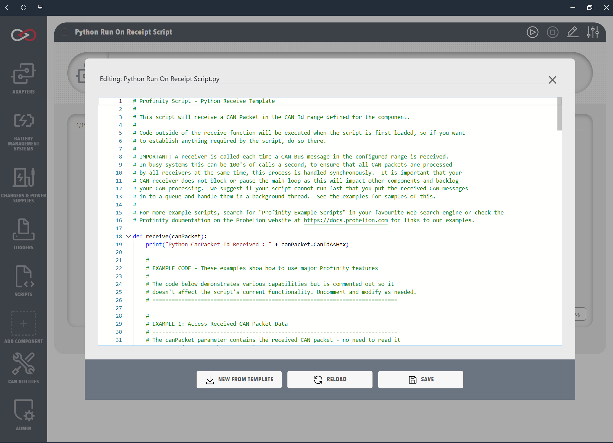

# Receive scripts

Receive scripts handle incoming CAN (Controller Area Network) messages in real time.
A script in Run On Receipt of CAN Message mode runs automatically when a matching CAN packet is received, and gets the packet as an argument.
This suits CAN bus monitoring, protocol implementation, and any case where an immediate response to a CAN message is needed.
The script implements a `Receive` method (C#) or a `receive` function (Python and Lua).

## Settings

Three settings decide which packets reach the script.

| Setting | Type | Default | Meaning |
|---------|---|---------|---------|
| **Base Address** | Hexadecimal number | 0 | The base CAN address of the device, entered in hexadecimal. |
| **Address Range** | Hexadecimal number | 0 | The number of addresses above Base Address that the script receives, entered in hexadecimal. A packet is received when its CAN ID is from Base Address to Base Address plus Address Range, inclusive, so 0 receives only the Base Address. |
| **Milliseconds Valid** | Time | 5000 | How long traffic from the device counts as valid before the connection is assumed lost. The range is -1 to 60000, and -1 means traffic never expires. |

<figure markdown>

<figcaption>Receive Script Editor</figcaption>
</figure>

## Example

The example is the minimum implementation of a Receive script in each supported language.
It implements the `Receive` handler, reads the CAN ID of the incoming packet in hexadecimal format with `CanIdAsHex`, and writes it to the Profinity console.

=== "C#"

    ```csharp
    using System;
    using Profinity.Sdk.Models.CANBus;

    public class CSharpReceiveExample : ProfinityScript, IProfinityReceiverScript
    {
        public void Receive(CanBusPacket canPacket)
        {
            Profinity.Console.WriteLine("CSharp CanBusId Received : " + canPacket.CanIdAsHex);
        }
    }
    ```

=== "Python"

    ```python
    def receive(canPacket):
        print("Python CanPacket Id Received : " + canPacket.CanIdAsHex)
    ```

=== "Lua"

    ```lua
    function receive(canPacket)
        print('Lua CanPacket Id Received : ' .. canPacket.CanIdAsHex)
    end
    ```

## Behaviour

A Receive script runs for each matching CAN packet, which on a busy bus can mean many invocations per second. If a run is still going when the next packet arrives, **Trigger Overlap** decides: **Drop**, the default, discards the packet, and **Queue** keeps up to **Queue Depth** packets (from 1 to 100, default 8) and runs them in order after the current run.
Keep the `Receive` or `receive` handler short, because a slow handler delays other work.
Avoid blocking calls such as `time.sleep` in Python and `Thread.Sleep` in C#, and avoid long calculations, locks, and slow input or output.

The **Trigger Overlap** setting decides what happens to a packet that arrives while the handler is still running, as described under [Script settings](./index.md#script-settings).
The Python and C# receive templates note that **Queue** keeps a short backlog.

Heavier processing belongs in a [Service scripts](./Service_Scripts.md), with the handler passing a small amount of data to a queue.

## Troubleshooting

| What you see | Cause | What to do |
|---|---|---|
| The script runs for some packets and misses others while it is busy | **Trigger Overlap** is **Drop**, the default, which discards a packet that arrives during a run | Set **Trigger Overlap** to **Queue**, set **Queue Depth** (1 to 100, default 8) to suit the traffic, and shorten the `Receive` or `receive` handler. |
| No packets reach the script | **Base Address** and **Address Range** do not cover the CAN IDs that the device sends | Set **Base Address** to the device's base CAN address and **Address Range** to cover its addresses, both in hexadecimal. |

