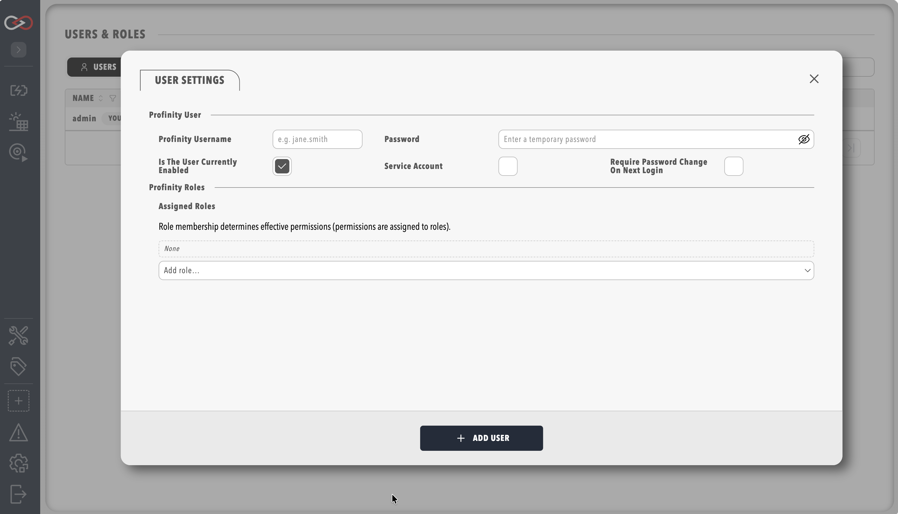

# Create a user

Create a user account for each person who signs in to Profinity, and give it the roles that match their job.
You need the **Security administration** permission and the **Profinity Server** licensed feature, which the **Server** and **Enterprise** editions include.

Without the Profinity Server feature, you can sign in, but you cannot create or manage user accounts or roles.
A Desktop installation runs as a single built-in desktop user, and **Users & Groups** shows that user and group administration needs the Profinity Server feature, which Enterprise also includes.
[Licensing](../Licensing.md) lists what each edition includes.

1. In the side menu, select **ADMIN**, then **Users & Groups**.
2. Select **+ Add user**.
3. Enter a username and an initial password for local sign-in.
4. Under **Assigned roles**, choose one or more roles.
    Only **Administrators** exists on a new installation.
    To assign another role, create it first by following [Create a role](../Administration/Users_and_Access/Create_a_Role.md), then return to this step.
5. Select **ADD USER** to create the user.

<figure markdown>

<figcaption>The Add user panel</figcaption>
</figure>

To check that it worked, select **LOGOUT** in the menu, then sign in as the new user with the initial password.
The new user sees only the pages their roles allow.
If you are not sure which roles to assign, refer to [Choose roles](#choose-roles) first.

## Choose roles

A user can only do what their roles allow, so give each person the smallest set of roles that lets them do their job.
The default **Administrators** role includes every permission, so assigning it gives that person the access of every other role.
Keep it for the few people who manage the installation.

[Create a role](../Administration/Users_and_Access/Create_a_Role.md) suggests Viewer, Operator, and Engineer roles to start from and explains how to build them.
[Roles and permissions](../Administration/Users_and_Access/Roles_and_Permissions.md) lists every permission.

To manage existing accounts, refer to [Managing users](../Administration/Users_and_Access/Manage_Users.md), which covers password resets and service accounts. A service account is an account for automation, with a token that never expires. You turn it on with the **Service Account** setting.
