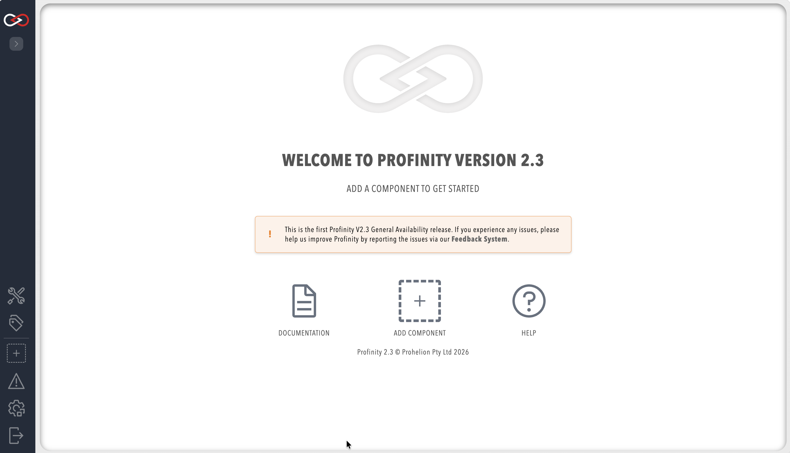

# Install Profinity on Linux and macOS

Install Profinity on Linux or macOS with the bootstrap installer, or from a downloaded archive.
For Windows, refer to [Install Profinity on Windows](./Windows_Installation.md), and for containers, refer to [Install Profinity with Docker](./Docker/index.md).

| Method | Use when | Result |
|--------|----------|--------|
| [Bootstrap installer](#install-with-the-bootstrap-installer) (`install.sh`) | You install on a Linux server or embedded device, or any host where Profinity should start on boot | Selects the right archive for the host, installs into `/opt/profinity`, creates the `profinity` service user, and on Linux with systemd creates the `profinity.service` unit |
| [Archive installation](./Linux_and_macOS_Archive_Installation.md) | You are trying Profinity, running it interactively, or installing without root or systemd | Files extracted into a folder of your choice, and started by hand with `./profinity.sh` |

## Install with the bootstrap installer

The installer downloads the release archive that matches the host operating system and CPU architecture, verifies it, and unpacks it into an install root, `/opt/profinity` by default.
On Linux with systemd it also creates the `profinity` service user, the [artefacts directory](./Artifacts_Directory.md), and the `profinity.service` unit.
Installing does not start Profinity. When it finishes, the installer prints `[profinity] Installed to` followed by the install folder, `/opt/profinity` by default.

On Linux, run the installer as root with `sudo`, unless you use `--no-systemd` with a writable `--install-dir`.
The host needs internet access, or a local archive as described under [Installer options](#installer-options).

1. Download the installer and its checksum:

    ```bash
    curl -fsSL -o install.sh https://github.com/Prohelion/Profinity/releases/latest/download/install.sh
    curl -fsSL -o install.sh.sha256 https://github.com/Prohelion/Profinity/releases/latest/download/install.sh.sha256
    ```

2. Verify the checksum and run the installer:

    ```bash
    sha256sum -c install.sh.sha256 && sudo bash install.sh
    ```

    On macOS, use `shasum -a 256 -c install.sh.sha256` in place of `sha256sum -c`.

3. On Linux, start Profinity as the service user with `sudo -u profinity /opt/profinity/profinity.sh` to test the configuration, because that user owns the data directory.
   On macOS, run `/opt/profinity/profinity.sh`.
   The log ends with a `Now listening on` line that gives the address to open, as in the sample output on [Install Profinity from an archive](./Linux_and_macOS_Archive_Installation.md).
   To start Profinity as a service instead, refer to [Run Profinity as a service](./Run_as_a_Service/index.md).

The installer can also be piped straight into the shell with `curl -fsSL https://github.com/Prohelion/Profinity/releases/latest/download/install.sh | sudo bash`.

!!! warning "Avoid this on production hosts"
    That trusts the network transport only and cannot verify the checksum, so avoid it on production hosts.

### Installer options

| Option | Default | Effect |
|--------|---------|--------|
| `--install-dir <path>` | `/opt/profinity` | Install into a different location than `/opt/profinity` |
| `--version <x.y.z>` | The latest release | Install a specific GitHub release, given as `x.y.z` or `vx.y.z`, instead of the latest. Ignored with `--channel`. |
| `--channel <name>` | GitHub releases | Download from a Prohelion file server channel instead of GitHub. Prohelion supplies the channel name and the installer address |
| `--package <archive>` | None | Install from a local `.tar.gz` or `.zip` in place of a download, for hosts without internet access. The checksum step is skipped for a local package |
| `--no-systemd` | Off | File-only install: skip the service user, artefacts directory, and systemd unit |
| `--dry-run` | Off | Print the planned actions without changing the system |

For a channel, download the installer from the address Prohelion supplies, then run it with the channel name:

```bash
sudo bash install.sh --channel <channel supplied by Prohelion>
```

### Update Profinity

`update.sh`, installed alongside `profinity.sh` in the install root, fetches the matching release for the installed edition. To update, run `/opt/profinity/update.sh`.
It swaps the application files in place.
It takes the same `--channel` and `--version` options as the installer, and does nothing if the installed version is already current.
Pass `--force` to reinstall anyway.

If the `profinity` service is active, `update.sh` stops it before it applies the update and restarts it afterwards.

## Where Profinity stores its data

On Linux, Profinity 2.3 stores writable data under `/var/lib/prohelion/profinity` by default, not `~/.local/share`, and it uses only that location.
On macOS the default is `~/Library/Application Support/Prohelion/Profinity`.

The bootstrap installer creates this directory, unless you pass `--no-systemd`.
For more information, refer to [Artefacts directory](./Artifacts_Directory.md).

## Open the web interface

Open the address that the `Now listening on` line of the log reports, or the `httpAddress` and `httpPort` values in `config.yaml`.
By default Profinity listens on all network interfaces (`0.0.0.0`) on port `18080`.
You reach it at `http://localhost:18080` on the local machine, or at `http://<host-name-or-ip-address>:18080` from another machine, where `<host-name-or-ip-address>` is the name or address of the machine that runs Profinity.
Other machines can open the web interface during the 14-day local trial and with a Server licence, as described in [Who can sign in, by installation type](./Applying_a_Licence.md#who-can-sign-in).

The browser opens the Profinity sign-in page.

<figure markdown>

<figcaption>Profinity sign-in page</figcaption>
</figure>

On a fresh installation, sign in as `admin` with the password `password`, and choose a new password when Profinity asks for one at first sign-in.
For the accounts on each installation type, refer to [Who can sign in, by installation type](./Applying_a_Licence.md#who-can-sign-in), and for how to choose the password, refer to the [Security guide](./Security.md#default-credentials).
After you sign in, the Profinity homepage appears.

<figure markdown>

<figcaption>Profinity homepage</figcaption>
</figure>

To stop Profinity in a terminal, press `Ctrl-C` in that window.
To stop it as a service on Linux, run `sudo systemctl stop profinity`, as described in [Run Profinity as a Linux service](./Run_as_a_Service/Run_as_a_Linux_Service.md).

## Troubleshooting

| What you see | Cause | What to do |
|--------------|-------|------------|
| On Linux, Profinity logs `Unable to create directory '/var/lib/prohelion/...'` and then fails to save its configuration | The account that runs Profinity does not own the directory | Run `sudo chown -R profinity:profinity /var/lib/prohelion` for the service user, or set `PROFINITY_HOME` to a path the account can write |

To keep Profinity running across restarts, refer to [Run Profinity as a service](./Run_as_a_Service/index.md).

