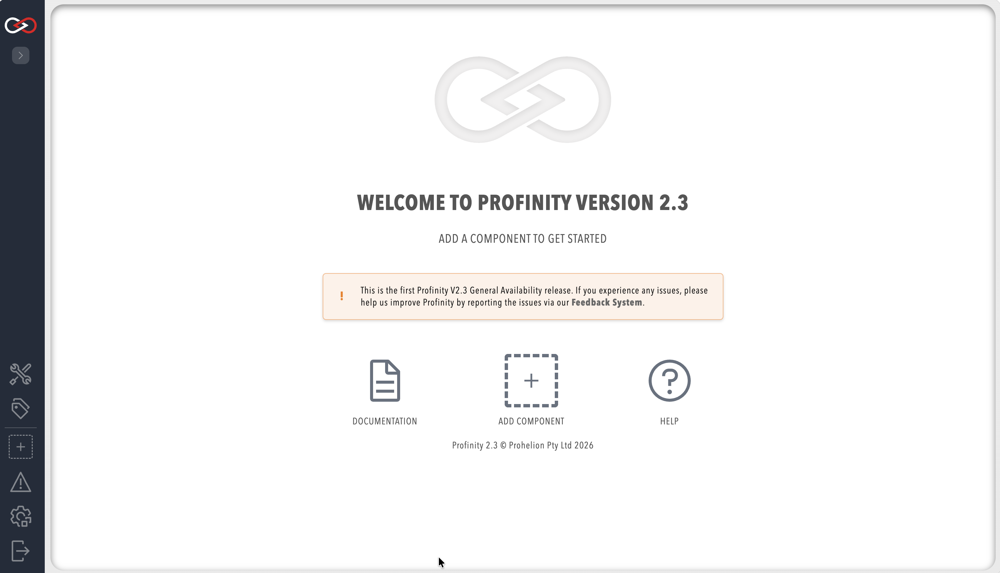

# Install Profinity on Windows

The Profinity Setup Wizard installs Profinity as a desktop application on Windows.
For Linux and macOS, refer to [Install Profinity on Linux and macOS](./Linux_and_macOS_Installation.md), and for containers, refer to [Install Profinity with Docker](./Docker/index.md).

The installer places Profinity in `C:\Program Files (x86)\Prohelion\Profinity`, and keeps configuration, profiles, and logs in the [artefacts directory](./Artifacts_Directory.md), which is `%LOCALAPPDATA%\Prohelion\Profinity` by default.
To upgrade a 2.2 installation, read [Upgrade from Profinity 2.2](./Upgrading/Upgrade_From_2_2.md) first.

## Install Profinity

Sign in with an account that has administrator rights. The installer sets Profinity up for all users in `C:\Program Files (x86)`.

1. Download `Profinity.Install.msi` from the [latest Profinity release on GitHub](https://github.com/Prohelion/Profinity/releases/latest).
2. Open `Profinity.Install.msi` and follow the prompts in the Setup Wizard.
3. Start Profinity from the Start menu.

Profinity opens its homepage in the desktop window.
To stop Profinity, shut down the application.

<figure markdown>

<figcaption>Profinity homepage</figcaption>
</figure>

## Open Profinity in a web browser

With Profinity running, open the URL set in the Profinity Web panel of [System configuration](../Administration/System_Configuration/Profinity_Web.md), which you reach from **ADMIN** in the side menu.
The default URL is `http://localhost:18080`, and the browser opens the Profinity sign-in page.

<figure markdown>

<figcaption>Profinity sign-in page</figcaption>
</figure>

The desktop application window signs in automatically, with no password.
| What you see | Cause | What to do |
|--------------|-------|------------|
| The browser sign-in page has no account to sign in with | No Server licence is applied | Use the desktop application window until you apply a Server licence |
| The browser cannot reach the address | Profinity is not running, or another program is using port 18080 | Check that Profinity is running and that no other program is using port 18080 |

## Remote access and user accounts

Until a Server licence is applied, the desktop application binds its web interface to the local machine (`127.0.0.1`) on TCP port 18080 by default, whatever address is set in System Configuration.
Other machines cannot open the web interface.
The installer adds Windows Firewall exceptions for ports 4876 (TCP and UDP) and 42000 (UDP), which the Tritium bridge and the SocketCANd or Candapter CAN adapters use. You do not need to do anything with them unless one of those adapters cannot be reached through the firewall.

A Server licence changes this.
Profinity then uses the address set in System Configuration, so other machines can open the web interface and sign in with their own accounts.

A Desktop licence leaves this out, and a Desktop host skips the 14-day local trial.
To apply a Server licence, refer to [Apply a licence](./Applying_a_Licence.md), and restart Profinity so that the new address takes effect.
For the accounts that exist with and without a Server licence, refer to [Who can sign in, by installation type](./Applying_a_Licence.md#who-can-sign-in).

## Next steps

Work through the [Quick start guide](../Getting_Started/Quick_Start.md) in the desktop window.
No licence or browser sign-in is needed.

To let other people sign in from a browser, apply a Server licence, select **ADMIN > Restart Profinity**, sign in as `admin`, change the password, and create accounts with [Create a user](../Getting_Started/Create_User.md).
Review the [Security guide](./Security.md), and run Profinity in the background with [Run Profinity as a Windows service](./Run_as_a_Service/Run_as_a_Windows_Service.md).
