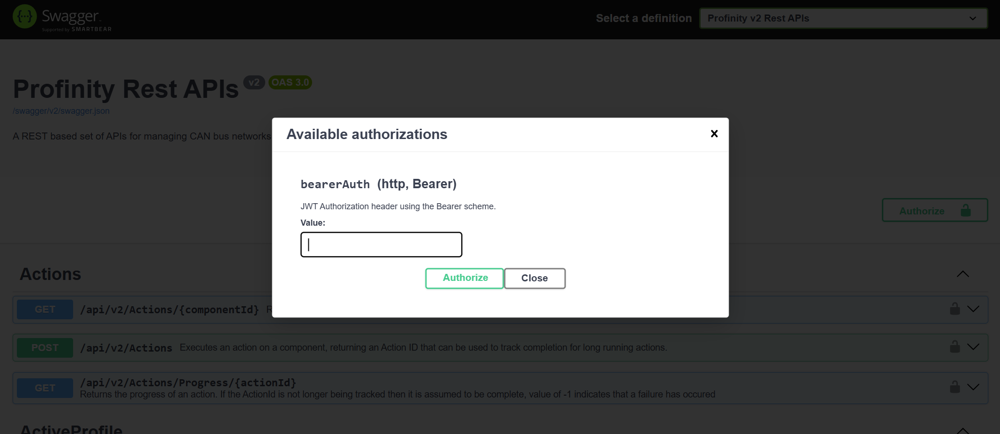

# Authenticate to the Profinity REST API

Get a Bearer token for the Profinity Representational State Transfer (REST) API, from a service account or a username and password sign-in, and send it with each request.
Use an account that is dedicated to the client and holds only the permissions the client needs.
For a guided first call, refer to [Make your first API call](../First_API_Call.md).

## What you need

- A Profinity user or [service account](../../Administration/Users_and_Access/Service_Accounts.md) for the client.
- The **Profinity Server** licensed feature, which a user account comes with. Refer to [Licensing](../../Licensing.md#features-by-edition) for the editions that include it.
- HTTPS for any client that calls Profinity across a network, because a sign-in sends the password. A client on the Profinity server can use `localhost`.
- For a service account token, an administrator who holds the **Security administration** permission.

## Get and use a token

A service account token has no expiry and no refresh token, so it suits a client that runs unattended.
It works until an administrator generates a new one, changes the account's roles, or disables the account.
A sign-in token expires and comes with a refresh token, so it suits an interactive client.

=== "Service account"

    1. Select **ADMIN** in the side menu, then **Users & Groups**.
    2. Select the service account's row, then select the **User Actions** tab.
    3. If the account already has a token, select **View Token** to show it, and go to step 5. **Generate Token** stops the old token at once.
    4. Select **Generate Token**, then confirm. The **Service account token** dialog shows the token.
    5. Select **Copy**, and store the token in a secrets manager.
    6. Send the token in each request as an `Authorization: Bearer <token>` header.

=== "Username and password"

    1. Send a `POST` request to `/api/v2/Users/Authenticate` with the `username` and `password` in a JSON body. Refer to [Get a token](../First_API_Call.md#get-a-token) for the command for each operating system.
    2. Copy the value of the `token` field in the response. If the response holds `preAuthToken` in place of `token`, complete the sign-in first, as described in [Sign-in responses](#sign-in-responses).
    3. Send the token in each request as an `Authorization: Bearer <token>` header.

To check the token, send it to an endpoint that the account has the permission for, such as the tag sample call in [Call an endpoint with the token](../First_API_Call.md#call-an-endpoint-with-the-token).
A `200` response with data shows the token works.

## Use Swagger with a token

The Swagger page lists every endpoint and its parameters, and can call the API for you.
Open it by adding `/swagger` to the Profinity address, such as `http://localhost:18080/swagger`.
Select the **Authorize** button and paste in the token.
To sign in with a user account, run `/api/v2/Users/Authenticate` on the Swagger page first, then authorise with the `token` it returns.

<figure markdown>

<figcaption>Entering the token in Swagger</figcaption>
</figure>

## Sign-in responses

A successful sign-in returns the access `token`, a `refreshToken`, the `username`, an `id`, and the user's `permissions`.
A user who must complete two-factor authentication or change a password first receives a `preAuthToken` in place of a `token`, with one of these flags set to `true`:

| Flag | What to send next |
|------|-------------------|
| `requiresTwoFactor` | `POST /api/v2/Users/Authenticate/TwoFactor`, with the `preAuthToken` as the Bearer token and a JSON body that holds the six-digit code from the user's authenticator app in `totpCode`, or a recovery code in `recoveryCode`. |
| `requiresPasswordChange` | `POST /api/v2/Users/Current/ChangePassword`, with the `preAuthToken` as the Bearer token and a JSON body that holds `currentPassword`, `newPassword`, and `confirmPassword`. |
| `requiresTwoFactorSetup` | Nothing through the API. The user enrols an authenticator by signing in to the web interface, as described in [Enrol an authenticator](../../Administration/System_Configuration/Security/Two_Factor_Authentication/Two_Factor_Sign_In.md#enrol-an-authenticator), and the client then signs in again. |

Each of the two endpoints returns a `token` and a `refreshToken` when it succeeds.

To renew a sign-in token before it expires, send `GET /api/v2/Users/Refresh` with the current token as the Bearer token and the `refreshToken` in an `X-Refresh-Token` header.
The response holds a new `token` and a new `refreshToken`.
Each refresh token works once, so send the newest one each time, because an older one returns `401`.
The endpoint needs a token that is still valid, so sign in again once a token has expired.
With a service account token, the endpoint returns the same token and no `refreshToken`.

## Fix 401 and 403 responses

| What you see | Cause | What to do |
|--------------|-------|------------|
| A `401` response. | The token is missing or has expired. | Sign in again to get a new token, or renew a token that is still valid with `GET /api/v2/Users/Refresh` before it expires. |
| A `401` response from a client that uses a service account token. | The old token stops working when an administrator generates a new one or disables the account. Changing the account's roles keeps the same token. | Get the current token from an administrator, who shows it with **View Token** on the account's **User Actions** tab. |
| A `403` response. | The user lacks the permission the endpoint needs. | Find the endpoint on the page for its API, read its **Permission** column, and ask an administrator to give the account a role that holds that permission. |

To read tag data with the token, refer to [Read real-time and historical tag data](Read_Tag_Data.md).
