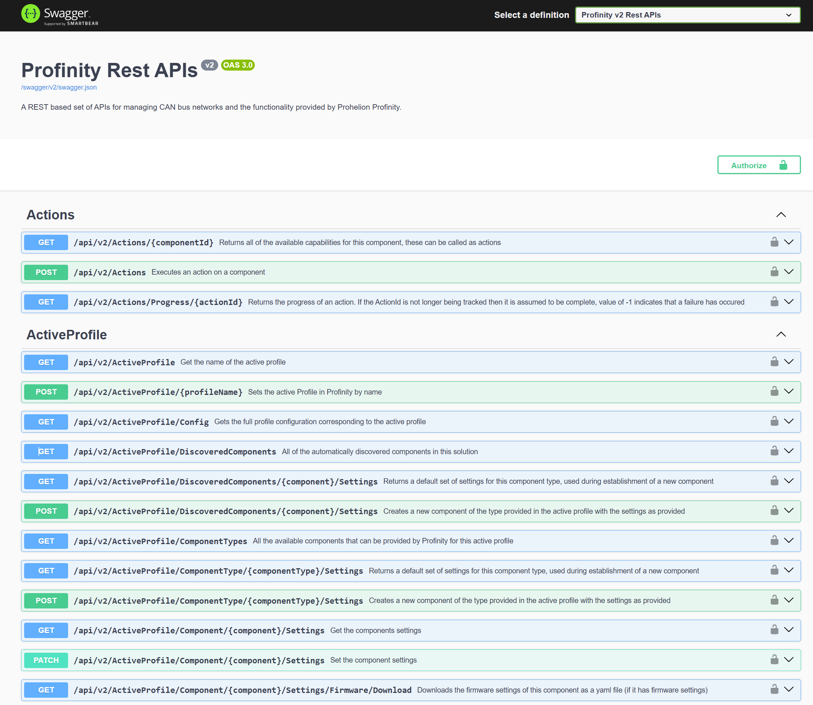

# Profinity REST APIs

Profinity V2 is built around its own Representational State Transfer (REST) APIs, which exchange JSON and are secured with Bearer tokens.
Custom applications use the APIs to connect other systems to Profinity, or to provide a custom user interface.
A custom user interface can be hosted either externally or within Profinity itself (refer to [Hosting](../../Customising_Profinity/Hosting/index.md)).

## Get started

- [Make your first API call](First_API_Call.md): sign in and request the latest sample of a tag with `curl`.
- [Authenticate to the Profinity REST API](API_Authentication.md): get a Bearer token from a service account or a sign-in, pass it in requests, and handle 401 and 403 responses.
- [Read real-time and historical tag data](Read_Tag_Data.md): read the latest and past values of a set of tags, with older values from the designated historian, poll for changes, and read one tag or signal.

## API reference

- [API reference](Reference/index.md): the page for each API, grouped as sign in, tags and alerts, profiles and components, CAN bus and DBC, and actions.

## API version and access

As of Profinity 2.3, `/api/v2` is the published shape of the REST API.
Errors are returned as `application/problem+json` documents.
Areas that are still being developed, such as firmware, can change between releases, so test a client built on them against each new release.

!!! warning "API users can damage equipment"
    The Profinity APIs support security and can be encrypted, but an API user can change system and equipment state.
    Grant API access only to the users and applications that need it, and limit what each of them can do, so that nobody can accidentally damage the environment or equipment.

The APIs are running whenever Profinity is running, and Profinity always publishes the API and Swagger on its own web address.
[Extensions Web](../../Administration/System_Configuration/Extensions_Web.md) serves extensions on a second web address, and the **Enable Profinity API** and **Enable Swagger on API** settings control the API and Swagger on that second address only.

## Swagger and the OpenAPI document

[Swagger](https://swagger.io) is the interactive API page on your Profinity instance.
Open it by adding `/swagger` to the URL that Profinity is running on.
For example, if Profinity is running on `localhost:18080`, the Swagger page is at `http://localhost:18080/swagger`.

The OpenAPI document is served at `/swagger/v2/swagger.json`.
API tools and AI skills can import it to generate a client or to read the available endpoints and models.

<figure markdown>

<figcaption>The Swagger page lists the Profinity APIs in groups, with the Authorize button at the right</figcaption>
</figure>
