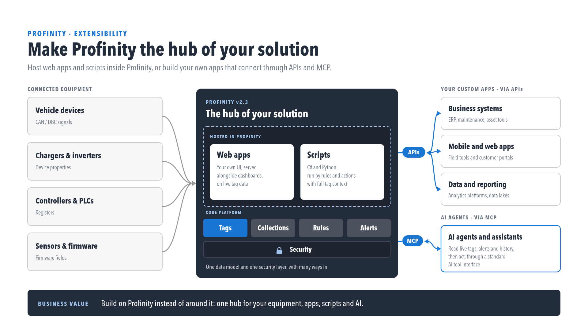

# Integrating to Profinity

Use the Profinity APIs and its Model Context Protocol (MCP) server to connect business systems, applications, and AI assistants to the tags, rules, and alerts in Profinity.
Business systems and applications call the Representational State Transfer (REST) [APIs](./APIs/index.md).
AI agents connect through the [MCP server](../Profinity_AI/MCP_Server/index.md).

<figure markdown>

<figcaption>Connected equipment feeds Profinity, which exposes its data to business systems through APIs and to AI agents through MCP</figcaption>
</figure>

## APIs

Profinity provides REST interfaces to integrate with and extend its functionality.
The APIs are secured with Bearer tokens and use JSON, so custom applications can be built on them, or existing applications extended with them.
They expose both real-time and historical data.
They connect Profinity to other systems, to custom dashboards, and to new applications built on Profinity's data.

The [APIs](./APIs/index.md) section documents every API, the interactive Swagger page on your instance, and the OpenAPI document that tools can import.
To make a first authenticated call, follow [Make your first API call](./APIs/First_API_Call.md).

## MCP server

Profinity includes an [MCP server](../Profinity_AI/MCP_Server/index.md), which lets [AI Chat](../Profinity_AI/AI_Chat.md) and external tools query system data and metadata.
The setup guides and the [MCP tool reference](../Profinity_AI/MCP_Server/Tool_Reference.md) are part of [Profinity AI](../Profinity_AI/index.md), under [MCP Server](../Profinity_AI/MCP_Server/index.md).

## Other ways to move data

APIs and MCP are for systems that call Profinity.
Data can also be pushed out of or into a Profinity instance without a custom client.

The [MQTT Publisher](../Components/Publishers_and_Subscribers/MQTT_Publisher.md) and [Webhook Publisher](../Components/Publishers_and_Subscribers/Webhook_Publisher.md) components send tag values to other systems.
The [MQTT Subscriber](../Components/Publishers_and_Subscribers/MQTT_Subscriber/index.md) component brings values in.
[Tag relay](../Tags/Tag_Relay.md) shares live tags between Profinity instances, and the receiving instance needs the **Receive external tags** permission.

## Scripting vs APIs

Profinity also offer scripting to extend its capabilities to meet the requirements of an application, more information on [Scripting](../Developing_with_Profinity/Scripting/index.md) can be found in that section of the documentation.

| Scripting | APIs |
|-----------|------|
| Scripts support C#, Python, and Lua | Any programming language that can call REST APIs and JSON can be used |
| Scripts are built in to Profinity and run inside it | API clients run outside Profinity, in a custom environment, app, or cloud, and can be distributed |
| Scripts can be developed quickly to solve simple problems | Applications can be as rich and complex as required and still use Profinity |
| Scripts can run without a user interface, on a schedule or triggered by CAN | The application supplies its own logic for how it uses the API |

## Plugins and developing in Profinity directly

For compiled integrations and packaged components, refer to [Developing with Profinity](../Developing_with_Profinity/index.md).
