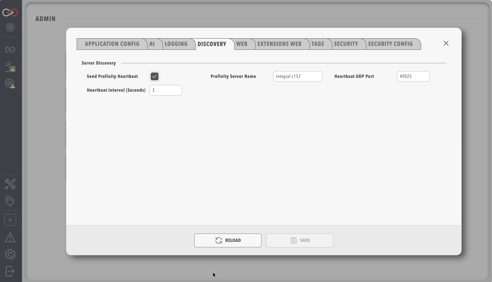

# Connect Profinity Mobile to a server

To connect Profinity Mobile to a server, check the discovery settings on the Profinity server, then select the server from the app's discovery list.
You need the app installed on the phone (refer to [Profinity Mobile](index.md)).
Before you start, check that other machines on the phone's network can open the server's web interface. Phones reach the server only when they can, which depends on the installation type and licence. The server needs the **Profinity Server** feature, because a Desktop host without it listens on this computer only (refer to [Who can sign in, by installation type](../Installation/Applying_a_Licence.md#who-can-sign-in)).

## Enable server discovery

Phones find a server only while it broadcasts a heartbeat, so check these settings on the Profinity server first.
The server sends heartbeats only while the web server is running and the machine has at least one network address other than loopback.

1. On the Profinity server, select **ADMIN** in the side menu, then [**System Configuration**](../Administration/System_Configuration/index.md), then the **Discovery** tab.
2. Set **Send Profinity Heartbeat** to on, then set the other settings in the table as needed. The **Heartbeat UDP port** and **Heartbeat interval (seconds)** settings apply only when the heartbeat is on. [Discovery](../Administration/System_Configuration/Discovery.md) describes each setting.
3. Select **SAVE**, then select **Save** in the confirmation prompt. Saving restarts Profinity and interrupts all active sessions, so save when no one needs the server.

| Setting | Type | Default | Description |
|---------|------|---------|-------------|
| **Profinity Server Name** | Text | The host name of the machine | The friendly name shown in the mobile list, which defaults to the host name of the machine (for example `Workshop-Profinity`) |
| **Send Profinity Heartbeat** | On or off | On | Turns the broadcast on or off, and is on by default |
| **Heartbeat UDP port** | Whole number | 49025 | The UDP port of the broadcast, 49025 by default |
| **Heartbeat interval (seconds)** | Time (seconds) | 3 | The time between broadcasts, from 1 to 60 seconds, 3 by default |

<figure markdown>

<figcaption>Server Discovery heartbeat settings</figcaption>
</figure>

The mobile app listens for the broadcast on UDP port 49025 by default.
If you change the **Heartbeat UDP port**, the app build must use the same port. The app reads the port when it is built, so a changed port needs a new build from the organisation that distributes the app (refer to [OEM white-label mobile builds](OEM_White_Label.md)).
Each entry in the app's discovery list shows the server name, the active profile, and the server's network addresses.

## Connect from the app

1. Connect the phone to the same Wi-Fi network and subnet as the Profinity server. Discovery uses a local broadcast, which routers do not pass between subnets.
2. Open Profinity Mobile.
   The discovery list shows the servers that are broadcasting a heartbeat.
3. Select your server and connect.
   The app opens the server's web sign-in page inside the app.
4. Sign in to the server's web page, using the first option that applies:
   - If the active profile has [Kiosk Mode](../Administration/Kiosk_Mode.md) enabled, the page signs you in automatically as the kiosk user. No further action is needed.
   - If the site uses single sign-on (SSO), select **Sign in with** and the name of your identity provider, then complete the sign-in.
   - Otherwise, sign in with your Profinity user name and password.

   If the site requires two-factor authentication, enter your authenticator code when prompted.
   After sign-in, the server's web interface opens in the app.

The app uses HTTPS when the server has it configured. For a self-signed certificate, the app shows a **Self-signed certificate** prompt, and you select **Trust and connect** to continue.

To return to the server list, swipe from the left edge of the screen on iOS.
On Android, use the system back action, which first steps back through the pages you opened in the app.
A certificate warning that you accepted for a server stays accepted when you go back.

If the discovery list is empty, refer to [Troubleshoot Profinity Mobile](Troubleshoot_Profinity_Mobile.md). If single sign-on does not complete, use the SSO row in that page's troubleshooting table.
