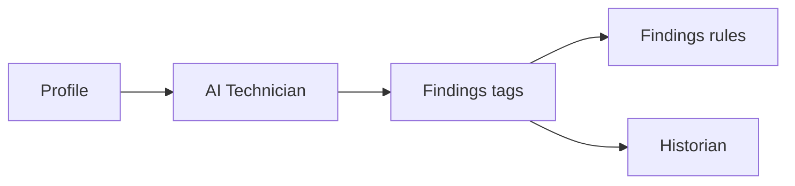

# AI Technician

The AI Technician component, in the **AI Agents** group, has [Profinity AI](../index.md) review the profile and publishes the verdict as tags.
It needs the **AI** licensed feature, included in the **Server** and **Enterprise** editions, and Profinity AI configured under [Profinity AI settings](../../Administration/System_Configuration/AI_Settings.md).
Each review is a round, and a round starts on a wake: a schedule, the **Run AI Technician** action, or an alert.
For what happens during a round, refer to [How AI technicians work](./How_AI_Technicians_Work.md).

<figure markdown>

<figcaption>The technician reads the profile and publishes findings tags, which the findings rules and a historian use like any other tags</figcaption>
</figure>

## Quick start

You need:

- Profinity AI set up and turned on, as described in [Profinity AI settings](../../Administration/System_Configuration/AI_Settings.md).
- An enabled user for the technician to run as, usually a [service account](../../Administration/Users_and_Access/Service_Accounts.md#run-an-ai-technician).
- The **Allow component actions** permission, for step 5.

1. Select **ADD COMPONENT**, then select **AI Technician** in the **AI Agents** group.
2. In **Run as**, choose the user.
3. On the **Instructions** tab, replace the example instructions with your own review, as described in [Write instructions](./Write_Instructions.md).
4. Select **ADD COMPONENT**.
5. Select **Run AI Technician** from the technician's menu.
6. When the round ends, check that the `Outcome` findings tag reads `attention` or `clear`.

The full procedure, with a schedule, is in [Set up an AI technician](./Set_Up_an_AI_Technician.md).

## Settings

Every setting is on the **Settings** tab, except **Instructions**, which has its own tab.

| Setting | Type | Default | Effect |
|---------|------|---------|--------|
| **Name** | Text | AI Technician | The component name. Rules name the technician by this name when they use it as an action. |
| **Enabled** | On or off | On | When off, every wake is dropped and no rounds run. |
| **Run as** | Dropdown of enabled users, required | None | The user each round signs in as. Its roles limit what the technician can see. |
| **Instructions** | Text, required, full width | An example industrial drive review | Instructions for the technician. Refer to [Write instructions](./Write_Instructions.md). |
| **Log output** | On or off | Off | Also writes the round log to the Profinity log. Dropped wakes and blocked rounds are written to the Profinity log whether this is on or off. |
| **Schedule** | No schedule, Run On Time Interval, or Run On CRON Schedule | No schedule | When scheduled rounds run. With No schedule, rounds start only from **Run AI Technician** and from alerts. |
| **Time Interval** and **Time Interval Unit** | Whole number and a unit | Empty, seconds | Shown when **Schedule** is Run On Time Interval. |
| **Cron Schedule** | Quartz cron expression | Empty | Shown when **Schedule** is Run On CRON Schedule. |
| **Timezone** | Timezone ID | Empty, which is Coordinated Universal Time (UTC) | The timezone for a cron schedule and for the day that **Daily limit** counts. |
| **Review window (hours)** | Whole number, 1 to 168 | 24 | How far back the technician is told to look. |
| **Round timeout (seconds)** | Whole number, 30 to 3600 | 300 | A round running longer than this stops with a `blocked` finding. |
| **Alert cooldown (minutes)** | Whole number, 0 to 1440 | 60 | Alert wakes are dropped for this long after a round ends. 0 turns the cooldown off. |
| **Daily limit** | Whole number, 0 to 1000 | 10 | The most alert and Run AI Technician rounds in one day. Scheduled rounds do not count. |

A Quartz cron expression has six or seven fields that start with seconds, so `0 0 0 * * ?` runs at midnight every day.
[Run scripts](../../Developing_with_Profinity/Scripting/Script_Types/Run_Scripts.md) describes the same format.
Profinity rejects a save with an expression or timezone it cannot read.

## Example

This example runs a review every night at midnight as a service account named `technician`.
Add it under `components:` in the `profile.yaml` file of the profile.

```yaml
- component:
    type: AiTechnicianComponent
    id: AiTechnicianComponent1
    name: AI Technician
    tagTreeParentPath: /
    enabled: true
    runAsServiceAccount: technician
    instructions: <your instructions>
    scheduleMode: CronSchedule
    cronSchedule: 0 0 0 * * ?
    reviewWindowHours: 24
    timeoutSeconds: 300
    alertCooldownMinutes: 60
    dailyLimit: 10
```

Replace `technician` with the user name of the account the technician runs as, and `<your instructions>` with the review.
The keys match the settings: `runAsServiceAccount` is **Run as**, `scheduleMode` is **Schedule**, `timeoutSeconds` is **Round timeout (seconds)**, and the others follow the setting names.

## Actions

The technician has two actions, which need the **Allow component actions** permission:

- **Run AI Technician** starts a round now. It is available while no round is running, and it counts towards the daily limit but not the cooldown.
- **Cancel Run** stops the round in progress, which ends with a `blocked` finding and the message `Round was cancelled`.

## Findings tags

The technician publishes these tags under its **Findings** branch.
Rules, dashboards, and historians use them like any other tag.

| Tag | Values |
|-----|--------|
| `Outcome` | `attention`, `clear`, or `blocked` |
| `Severity` | 0 for none, or 1 (Trace), 2 (Debug), 3 (Info), 4 (Warning), 5 (Error), 6 (Fatal) |
| `SeverityName` | The severity as text, such as `Warning`, or empty for none |
| `Message` | A short summary of the finding, or the reason a round was blocked |
| `Wake` | `schedule`, `manual`, or `alert`, the wake that started the round |
| `RoundTime` | The time the round finished, in UTC |
| `Report` | The round report: the wake, and the AI's visible reply |
| `FailedRounds` | The number of `blocked` rounds in a row, reset to 0 by an `attention` or `clear` finding |

The technician also publishes `RoundStatusMessage`, which reads `running`, `attention`, `idle`, or `blocked`, and `NextWakeMessage`, which holds the next scheduled round in UTC or `none`.

Profinity saves the last finding and restores it when Profinity or the profile restarts, so an alert raised from a finding stays raised after a restart.
A new technician has no finding, so its findings tags have no value and no findings rule fires until the first round ends.

## Built-in rules

The technician ships three rules, which you open and change with **Edit Rules** on the technician, as described in [Tag rules](../../Tags/Rules/index.md).
None of them ships an action.
Add the actions you want, such as an email at Warning and above.

| Rule | Raises |
|------|--------|
| **Findings severity** | An alert at the level of the `Severity` tag, from Trace to Fatal. It clears when a `clear` finding sets `Severity` to 0. |
| **Findings message** | A Warning when the `Message` tag changes and the outcome is `attention`. The same text does not send again. A `clear` finding ends the alert. A `blocked` round leaves it raised and does not send. |
| **Technician not working** | A Warning when `FailedRounds` reaches 3, at most once an hour. |

**Findings message** sends each distinct attention finding, even when two rounds give the same severity.
Its **On update** setting is on, so it fires again while its expression is already true, as described under [On update](../../Tags/Rules/Rule_Settings.md#on-update).
The shipped expression sends only `attention` rounds.
Edit that expression if blocked or clear rounds should send as well.
Its related tags name the other findings tags, so the expression and the action message can read them, as described under [Related tags](../../Tags/Rules/Rule_Settings.md#related-tags).

Refer to [Rule actions](../../Tags/Rules/Actions/index.md) for the actions a rule can run.

## Dashboard

The technician dashboard needs the **View tags** permission.
Its status pill shows **STATUS**, from `RoundStatusMessage`, and **NEXT**, from `NextWakeMessage`.
The **Findings** panel shows **Outcome**, **Severity**, **Message**, **Woken by**, and **Round time**.

The **Last round** panel shows the round log while a round is running: the round start, each step, the finding, and the round end.
The log is cleared when the next round starts, and a dropped wake is added to it.
The log is held in memory, so it is empty after Profinity restarts.
When no round is running, the panel shows the `Report` tag instead, with its line breaks kept.
A historian that stores text can show that report at a past time, as described in [View a dashboard at a past time](../../How_To_Guides/View_Dashboard_at_a_Past_Time.md).

## Keep a history of findings

To look back at past findings, record the findings tags with a historian, as described in [How to configure data logging](../../How_To_Guides/Configure_Data_Logging.md).
`Outcome`, `SeverityName`, `Message`, `Wake`, and `Report` hold text.
A [TAG SQL Historian](../../Components/Historians/TAG_SQL_Historian.md) or [TAG Local Historian](../../Components/Historians/TAG_Local_Historian.md) stores text, and an [InfluxDB historian](../../Components/Historians/InfluxDB_Historians.md) stores only tags that hold a number.

`Report` is the largest tag, so include it in the logged collection only when you want the report kept for every round.

## Troubleshooting

| What you see | Cause | What to do |
|--------------|-------|------------|
| `Outcome` is `blocked` and `Message` reads `AI is not licensed or configured` or `AI settings are incomplete` | Profinity AI is not licensed, or its settings are not complete | Complete [Profinity AI settings](../../Administration/System_Configuration/AI_Settings.md), and check the edition in [Licensing](../../Licensing.md). |
| `Message` reads `Run as user was not found or is disabled` | **Run as** names no user, or a disabled user | Set **Run as** to an enabled user. A [service account](../../Administration/Users_and_Access/Service_Accounts.md) is the usual choice. |
| `Message` reads `Model did not call record_finding` | The AI replied without giving a verdict | Make the instructions end with a clear instruction to give a verdict, as described in [Write instructions](./Write_Instructions.md). |
| `Message` reads `Round timed out` | The round took longer than **Round timeout (seconds)** | Increase the timeout, or narrow the instructions and **Review window (hours)**. |
| **Run AI Technician** or an alert does nothing | Profinity dropped the wake. The [Profinity log](../../Administration/Logs_Config.md) has a line `AI technician '<name>': dropped` with the reason, which the table in [Dropped wakes](#dropped-wakes) explains. | Fix the cause for the reason in the log. |
| A finding names data the technician should have seen as missing | The **Run as** account lacks the permission to view it | Add the view permissions to the account's role, as described in [Service accounts](../../Administration/Users_and_Access/Service_Accounts.md#run-an-ai-technician). |
| Text findings are empty when a dashboard is viewed at a past time | The designated historian is an InfluxDB historian, which stores numbers only | Use a TAG SQL Historian or TAG Local Historian as the [designated historian](../../Components/Historians/Designated_Historian.md). |
| **Technician not working** alert | Three rounds in a row were `blocked`. | Read the `Message` tag and find its text in this table. |


### Dropped wakes

| Reason in the log | Cause | What to do |
|---|---|---|
| `DroppedDisabled` | **Enabled** is off. | Turn on **Enabled**. |
| `DroppedBusy` | A round was already running. | Wait for the round to end, then select **Run AI Technician** again. |
| `DroppedCooldown` | An alert arrived within **Alert cooldown (minutes)** of the last round. | Wait for the cooldown, or lower **Alert cooldown (minutes)**. |
| `DroppedDailyLimit` | The day's alert and **Run AI Technician** rounds reached **Daily limit**. | Wait for the next day in **Timezone**, or raise **Daily limit**. |
| `DroppedLoopGuard` | The alert came from a rule on the technician's own findings tags, which would start rounds in a loop. | Leave the technician out of the actions of its own findings rules. |

To have device alerts start a round, continue to [Investigate alerts with an AI technician](./Investigate_Alerts_with_an_AI_Technician.md).
