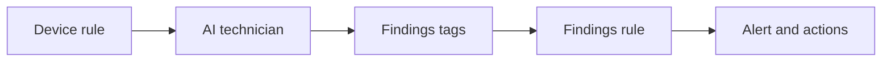

# How AI technicians work

An AI technician runs a *round*: one unattended review by [Profinity AI](../How_Profinity_AI_Works.md), which ends with a finding published as tags.
The technician advises and never acts, so a person or an ordinary [tag rule](../../Tags/Rules/index.md) decides what happens next.

## What wakes a technician

Three things start a round:

- A schedule, set on the **Settings** tab as a time interval or a Quartz cron expression, such as a review at midnight every day.
- A user with the **Allow component actions** permission selecting **Run AI Technician** on the technician.
- An alert from a tag rule on another device that names the technician as one of its [rule actions](../../Tags/Rules/Actions/index.md).

A technician runs one round at a time.
A wake that arrives while a round is running is dropped, and it is not queued or tried again.
The next section lists the other limits that drop a wake.

## From a device rule to an alert

A technician never raises an alert itself.
It publishes its finding on its own **Findings** tags, and the built-in rules on those tags raise the alert and run its actions, in the same way as any other rule.

<figure markdown>

<figcaption>A device rule wakes the technician, the technician publishes its findings tags, and the findings rule raises the alert and runs its actions</figcaption>
</figure>

Keeping alerts in rules means the findings appear in the Alerts Log beside every other alert, use the same alert levels, and run the actions you already use, such as an email or a Slack message.
It also means the device rule fires straight away, and the technician's view arrives later as a second alert when the round ends.

Each finding has one of three outcomes:

| Outcome | Meaning | Severity tag |
|---------|---------|--------------|
| `attention` | The device needs a person to look at it | 1 (Trace) to 6 (Fatal), chosen by the AI from the instructions |
| `clear` | Nothing to report | 0, so the findings alert clears |
| `blocked` | The round could not finish, for example the provider did not answer | Unchanged from the last finding |

A blocked round leaves the last severity in place, so one failed round does not clear an alert that is still valid.
Three blocked rounds in a row raise the **Technician not working** alert instead.

## What the AI sees and keeps

Each round signs in as the user named in **Run as**, so the AI sees only the tags, alerts, and rules that user's roles allow.
The tools it uses are the read-only tools of the [MCP Server](../../Integrating_to_Profinity/MCP_Server/index.md), so a technician cannot change a tag, a setting, or a device.

The AI receives the technician's instructions, the review window, and the previous finding.
When an alert wakes it, the AI also receives that alert, marked as device data to investigate and not as instructions.
The previous finding lets it keep a verdict steady from one round to the next, instead of changing its view on the same data.

Profinity keeps the AI's visible reply as the round report, in the `Report` tag.
It does not keep the model's hidden reasoning.

Rounds send device data to the configured AI provider without anyone at the screen.
Refer to [Profinity AI settings](../../Administration/System_Configuration/AI_Settings.md) for the provider and what leaves the instance.

## Limits that keep AI reviews rare

An AI round takes time and costs money, so a technician drops wakes that arrive too often.
Each limit is a setting on the technician, described on [AI Technician](./AI_Technician.md#settings).

| Limit | Applies to | Effect |
|-------|------------|--------|
| One round at a time | Every wake | A wake during a round is dropped. |
| **Alert cooldown (minutes)** | Alert wakes | An alert within this time of the end of the last round is dropped. |
| **Daily limit** | Alert and Run AI Technician wakes | Once this many rounds have run today, in the technician's timezone, further wakes are dropped until midnight. |
| Own findings | Alert wakes | A rule on the technician's own findings tags cannot wake it, so a finding never starts another round. |

Scheduled rounds ignore the cooldown and the daily limit, so a daily review always runs unless a round is already in progress.
A press of Run AI Technician ignores the cooldown, because a person chose to run it, but still counts towards the daily limit.

To add a technician to a profile, continue to [Set up an AI technician](./Set_Up_an_AI_Technician.md).
