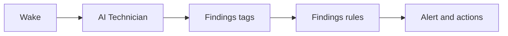

# AI Technician

An AI Technician does the checking that a service technician would otherwise do in the field.
It reviews a device the way an experienced technician would, by reading its recent history and comparing nearby tags, and it tells you whether the device needs attention.

This changes how servicing works.
Without an AI Technician, a service technician checks each device, whether or not anything is wrong, and problems that build slowly are found on the next visit.
With one, [Profinity AI](../index.md) checks the device regularly, on a schedule or when an alert fires, and your service technician is called automatically only when it finds something.
The visit changes from a routine inspection to a response to a specific finding.

An AI Technician is a component.
You write its instructions once, as you would brief a new technician, and it publishes each answer as tags.
Your [tag rules](../../Tags/Rules/index.md) turn an answer into an alert and send it to the people who respond, in the same way they handle any other tag.

A profile often has several AI Technicians, each with its own instructions and schedule.
One might review the motor temperatures every night, a second might look into pump alerts as they happen, and a third might check the cooling system once a week.
Each one covers a different problem, the way a site would have different technicians for different equipment, and each has its own limits and its own findings.

Each answer is either `clear` or `attention`.
An `attention` answer carries a severity, from Trace to Fatal, and a short message such as "Motor temperature has risen 6 °C over 24 hours and is still climbing".
The technician only reads, so it never changes a device. What happens next is up to your rules.

An AI Technician needs the **AI** licensed feature, which is part of the **Server** and **Enterprise** editions, as listed in [Licensing](../../Licensing.md).

!!! info "Each round sends device data to the AI provider"
    Each round sends device data to the AI provider set in [Profinity AI settings](../../Administration/System_Configuration/AI_Settings.md), unless your administrator has set up a local, self-hosted model.
    Rounds run unattended, so check that the provider meets your organisation's data rules before you turn a technician on.

## Why use an AI Technician

Tag rules are good at fixed limits.
A rule that alerts at 80 °C checks every reading as it arrives and costs nothing to run.

Some faults take days to show.
A motor that runs a few degrees hotter each day stays under its 80 °C alarm until it is close to failing.
A technician that reviews the last 24 hours every night spots the climb while there is still time to plan a repair.

A technician also saves time when an alert fires.
Normally an engineer opens the history, compares the nearby tags, and scrolls back through the Alerts Log to see whether it has happened before.
A technician woken by the alert does that work first, and its assessment arrives as a second alert when the round ends.
The engineer starts with an answer, such as "third time this week, each after a long climb in temperature", and decides what to do next.

The instructions are written down, so every round applies the same checks, whoever is on shift.
An experienced engineer's checklist becomes something the technician runs every night.

To ask a question yourself, in your own words, use [AI Chat](../AI_Chat.md).

## How an AI Technician works

Each review is called a *round*.
A round starts on a schedule, when a user selects **Run AI Technician**, or when a rule on another device names the technician as one of its actions.

During a round, Profinity AI follows your instructions.
It reads tag values and history, alerts, and alert rules through the read-only tools of the [MCP Server](../../Integrating_to_Profinity/MCP_Server/index.md), signed in as the user named in **Run as**, so it sees what that user can see.
When an alert started the round, the technician also gets the details of that alert.

The round finishes with `attention` when a person needs to look, `clear` when all is well, or `blocked` when the round stopped early, for example because the AI provider timed out.

<figure markdown>

<figcaption>A schedule, a user, or an alert wakes the technician, the technician publishes its findings tags, and the findings rules raise the alert and run its actions</figcaption>
</figure>

The technician writes its answer to tags under its **Findings** branch: the outcome, the severity, the message, and a report of what it checked.
Built-in rules on those tags raise alerts in the [Alerts Log](../../Tags/Alerts.md), next to every other alert, and you add the actions, such as an email or a Slack message.
A dashboard shows the latest finding.
A historian that stores text keeps each finding, so you can look back at what the technician said about a device on any day.

[How an AI Technician works](./How_AI_Technicians_Work.md) goes through rounds, wakes, and limits in detail.

## Leaving a technician running

A technician runs as a user, usually a [service account](../../Administration/Users_and_Access/Service_Accounts.md#run-an-ai-technician) with read-only roles.
Its tools only read, so the profile stays exactly as it was.

AI rounds take time and cost money, so each technician has limits.
It runs one round at a time, waits out a cooldown after each alert, and stops at a daily limit, so a burst of alerts starts one review, not fifty.
Scheduled rounds skip the cooldown and the daily limit, so the nightly review always runs.

If a round fails, the technician reports `blocked` and keeps the previous severity, so a valid alert stays raised.
After three failed rounds in a row, it raises a **Technician not working** alert.

In Profinity 2.3, a wake that arrives during a round is dropped, and every technician uses the one AI provider and model set for the instance.
The round log on the dashboard is cleared when Profinity restarts, but the last finding is saved and restored.

## Set up and use an AI Technician

Start with [Set up an AI Technician](./Set_Up_an_AI_Technician.md), which adds a technician from the **AI Agents** group, gives it a service account and a schedule, and checks its first finding.

- [Write instructions](./Write_Instructions.md) shows how to write instructions that give a reliable answer, with a nightly service check and an alert investigation as examples.
- [Investigate alerts with an AI Technician](./Investigate_Alerts_with_an_AI_Technician.md) has a device rule wake the technician when an alert fires.
- [AI Technician](./AI_Technician.md) lists the settings, the findings tags, the built-in rules, and the dashboard, and covers troubleshooting.
- [How an AI Technician works](./How_AI_Technicians_Work.md) explains rounds, wakes, and the limits that keep AI reviews rare.
