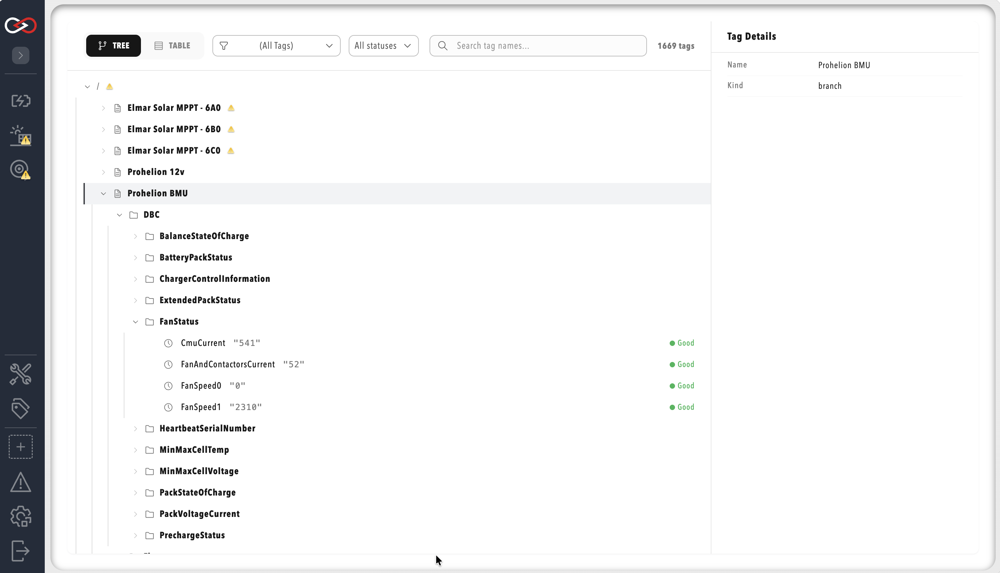

# Tag paths

Every tag has one address, its path from the root of the tag tree.
A path is written like a folder path, with a `/` between its parts, such as `/Vehicles/Car1/Charger/DBC/BMSInfo/Flag`.
The parts below the root are the folders a component is nested in, if any, then the component, then its groups and tags.
**TAG EXPLORER** shows the path of every tag, so check a path there before you use it.

## Absolute and relative paths

A path that starts with `/` is absolute.
It is read from the root of the tag tree, so it means the same tag wherever you write it.

A path with no leading `/` is relative.
Profinity reads it from a starting point that depends on where you write it.

| Where the path is written | A relative path starts at |
|---|---|
| A bind `source:` on a component's dashboard | That component |
| The scope of a component's own rules | That component |
| A scope at the top of the profile's rules or collections | The root of the tag tree |
| The scope of a group inside rules or collections | The scope of the group that contains it |
| A script | The component that runs the script, as described in [Tags](../../Developing_with_Profinity/Scripting/Script_Operations/Tags.md) |

In the scope of a group, a leading `/` starts again from the root instead of adding to the parent group's scope, and `/` on its own selects every tag in the tree.

A relative path always goes under its starting point, even when it begins with the same text.
A group scope of `Pack1/Cells` inside a scope of `Pack1` means `Pack1/Pack1/Cells`.
To start again from the root, begin the path with `/`.

## Nest a component with a Tag tree path

By default each component sits at the root of the tag tree under its own name.
The **Tag tree path** setting gives it a parent folder, so that its tags nest under that location instead.
You can find it in the **Component identifier** section of the component's settings, next to **Name**.

Nesting suits profiles that model physical or logical groupings.
Examples are several subsystems of one vehicle, or several instances of one component type that represent the bays, strings, or vehicles in a fleet.
The shared folder appears in the tag tree and in **TAG EXPLORER**, so an integrator or user can navigate the tree the way the physical system is organised.

The following sketch shows the effect of giving two components a **Tag tree path** of `Vehicles/Car1`:

```text
Without a Tag tree path          With a Tag tree path of Vehicles/Car1
Charger/                         Vehicles/
Inverter/                          Car1/
                                     Charger/
                                     Inverter/
```

In the **TAG EXPLORER** example below, each component appears as a branch under the root of the tree, and its tags are grouped into folders such as `DBC`.
A component with a **Tag tree path** set appears in the same way, inside its parent folders instead of at the root.

<figure markdown>

<figcaption>Full Tag Explorer example with components mounted at the root, the default</figcaption>
</figure>

The default **Tag tree path** is `/`, which places the component at the root.
`Vehicles/Car1` and `/Vehicles/Car1` place it at the same location.
To set the path, refer to [Nest a component in the tag tree](Nest_a_Component_in_the_Tag_Tree.md).

A nested component's path includes its folders everywhere a path is read from the root.
In the profile's collections and rules, the tags of a `Charger` component with a **Tag tree path** of `Vehicles/Car1` are scoped with `Vehicles/Car1/Charger`.
The component's own rules start at the component, so a `scope.prefix` of `DBC` resolves to `Vehicles/Car1/Charger/DBC`, or to `Charger/DBC` when the component sits at the root.

## Absolute and relative dashboard binds

Once a component is nested, the form of a `source:` value in a dashboard `bind:` entry decides whether it follows the component if it moves.

| | Relative bind | Absolute bind |
|---|---|---|
| Form | No leading slash | Leading slash |
| Example | `DBC/BMSInfo/Flag` | `/Vehicles/Car1/Charger/DBC/BMSInfo/Flag` |
| Resolved | Against the component's own location when the dashboard loads | Used exactly as written |
| Use for | A dashboard reading its own component's tags, which is the normal case | A dashboard reading another component's tags, such as the profile home dashboard |
| If the component moves | Continues to resolve | Stops resolving until updated |

On a dashboard belonging to that `Charger` component, the relative bind `DBC/BMSInfo/Flag` resolves to `Vehicles/Car1/Charger/DBC/BMSInfo/Flag`.

Dashboards that use the `{COMPONENT_NAME}` placeholder, documented in [Data binding](../../Customising_Profinity/Dashboards/Data_Binding/index.md), keep working.
Profinity replaces the placeholder with an explicit relative or absolute path the next time the dashboard is saved.

## What a path can contain

Paths work the way paths do in a Unix file system.
A part can hold any text, including spaces inside it, such as `Elmar Solar MPPT`, and parts are separated by `/`.
Extra slashes and a slash at the end make no difference, so `Site//Line1/` and `Site/Line1` are the same path.
A `.` means the folder you are in, and `..` means the folder above it, so `../Meter/Power` reads from the folder beside the starting point.
A `..` at the top of the tree stays at the top.
Profinity shows a path exactly as you typed it.

The fields that take a path in the rules, collections, derived tags and dashboard editors check it as you type, and show a message when the path breaks one of these rules.
The **Tag tree path** of a component and the **Receiver tag path prefix** of a tag relay receiver are checked the same way.

| Not allowed | Message |
|---|---|
| An empty path where one is required | Enter a tag path. |
| A space at the start or end of a part, or a part that is only spaces | A part of the path cannot start or end with a space, or be only spaces. |
| A `*` in a path that names a tag, such as a bind `source:` or a **Tag tree path** | A tag path cannot contain *. Use a pattern to match several tags. |
| A `*` in the middle of a part of a scope, such as `Out*Current` | A * may only be at the start or end of a part of a pattern, or be the whole part. |
| A control character, such as a tab or a line break | A tag path cannot contain control characters. |
| A part longer than 128 characters | A part of the path is longer than 128 characters. |

A scope can use `*` at the start or end of a part, as described in [Wildcards](Tag_Expressions.md#wildcards).
The rules, collections and derived tags editors also refuse to save a file that holds a path breaking these rules, on the YAML tab as well as in the visual editor, and the message names where the path is.

## Capital letters

Profinity keeps every name exactly as it was typed, so `Pump` and `pump` are different names, and every path is compared exactly.
This applies to a bind `source:`, a path in a script, a derived tag's dependency, a scope, and a tag expression, so `tag.MatchesPath("pump")` does not select the tags under `Pump`, and `Pump/Speed` does not find a tag called `pump/Speed`.
The `*` wildcard follows the same rule, so `*current*` does not match `OutputCurrent`.

There are two places where capitals do not matter.
The search in **TAG EXPLORER** ignores them, because it is a search and not an address.
Component names are the exception to the rule: Profinity does not let you add or rename a component to a name that differs from another component's only in capitals, because each component has its own folder on disk.

Write every path with the spelling shown in **TAG EXPLORER**, including in scopes and expressions.
When Profinity loads the profile's rules, collections and derived tags, it records a warning in the [logs](../../Administration/Logs_Config.md) for each path that matches nothing as written but would match a tag if capitals were ignored, and gives the spelling to use.
